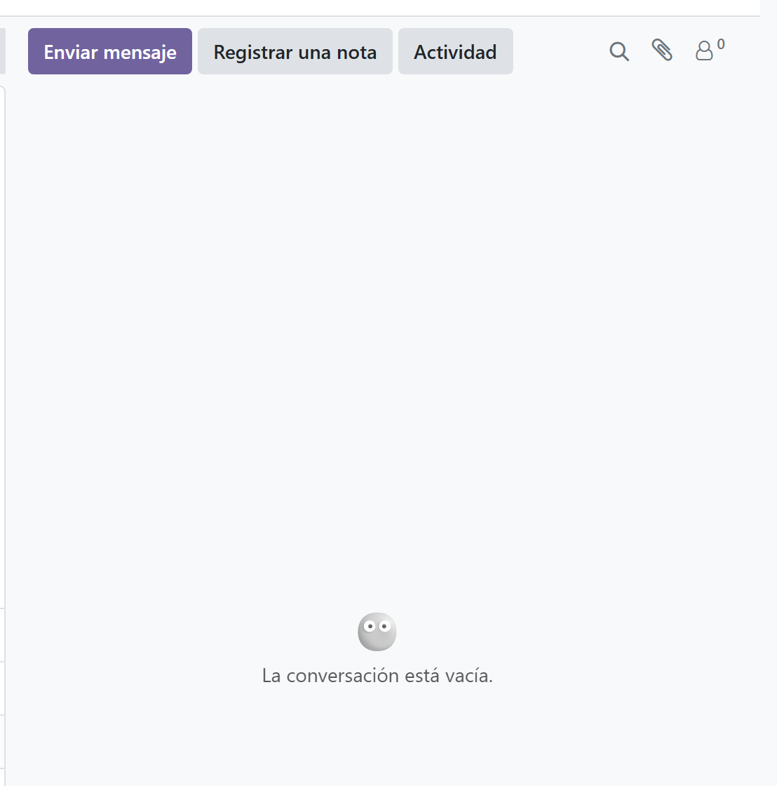

Abrí cualquier documento de Odoo y abajo vas a encontrar lo mismo: un historial de mensajes, una lista de seguidores y un panel de actividades pendientes.

Eso se llama **chatter**, y se agrega con dos líneas.


*Las líneas de «Técnico» y «Estado» las generó `tracking=True`; nadie las escribió.*

## Los dos mixins

```python models/service_order.py
class ServiceOrder(models.Model):
    _name = "service.order"
    _inherit = ["service.sequence.mixin", "mail.thread", "mail.activity.mixin"]
    _description = "Orden de servicio"
```

Acordate de la lección de herencia: `_inherit` acepta una lista, y `mail.thread` y `mail.activity.mixin` son `AbstractModel` del core.

- **`mail.thread`** — mensajes, seguidores y seguimiento de cambios.
- **`mail.activity.mixin`** — actividades: «llamar al cliente el martes».

Y en la vista:

```xml views/service_order_views.xml
        </sheet>
        <chatter/>
    </form>
```

Va **después de `</sheet>`**, no adentro.

> **Si venís de versiones anteriores**
> Esto se escribía con un `<div class="oe_chatter">` y tres campos adentro: `message_follower_ids`, `activity_ids` y `message_ids`. En Odoo 19 es la etiqueta `<chatter/>` y nada más.

## Ahora sí, `tracking`

En la lección de campos dejamos esto pendiente, porque `tracking` solo es válido con `mail.thread`. Ya lo tenemos:

```python models/service_order.py
state = fields.Selection([...], tracking=True)
user_id = fields.Many2one("res.users", tracking=True)
date_done = fields.Date(tracking=True)
```

Cada cambio en esos campos **queda registrado en el chatter**: quién, cuándo, de qué valor a cuál.

Es lo más barato que podés agregarle a un modelo de negocio. Cuando alguien pregunte por qué una orden pasó a «Entregado» sin reparar nada, la respuesta está ahí.

No lo pongas en todos los campos: cada uno marcado genera una línea de historial, y un documento con veinte campos rastreados produce un chatter ilegible. Elegí los que cuentan la historia: estados, responsables, fechas clave, importes.

El valor de `tracking` puede ser un entero para ordenar cómo se muestran los cambios agrupados.

## Escribir en el chatter desde código

```python models/service_order.py
def action_deliver(self):
    self.ensure_one()
    self.state = "done"
    self.message_post(body="Equipo entregado al cliente.")
```

`message_post` es el método. Los argumentos que importan:

```python
self.message_post(
    body="<p>Equipo <b>entregado</b>.</p>",
    subject="Orden entregada",
    message_type="comment",
    subtype_xmlid="mail.mt_comment",
)
```

**El `subtype` decide si se manda por correo o no**, y es la distinción importante:

- **`mail.mt_note`** — una nota interna. Queda en el historial y **no se envía a nadie**.
- **`mail.mt_comment`** — un mensaje. **Se envía por correo a los seguidores**.

Por defecto `message_post` usa `mt_note`. Si querés que el cliente reciba algo, tenés que pedirlo explícitamente — y eso está bien pensado: evita mandar correos sin querer.

## Seguidores

```python
self.message_subscribe(partner_ids=[self.partner_id.id])
self.message_unsubscribe(partner_ids=[self.partner_id.id])
```

Los seguidores son quienes reciben los mensajes de tipo comentario. Suscribir al cliente cuando se crea la orden tiene sentido: a partir de ahí se entera de lo que pasa.

Ojo con suscribir a mucha gente: cada mensaje se multiplica por la cantidad de seguidores, y es la forma más rápida de que un equipo empiece a ignorar las notificaciones de Odoo.

## Actividades

```python models/service_order.py
def action_diagnose(self):
    self.ensure_one()
    self.state = "diagnosis"
    self.activity_schedule(
        "mail.mail_activity_data_todo",
        date_deadline=fields.Date.context_today(self) + timedelta(days=2),
        summary="Terminar el diagnóstico",
        user_id=self.user_id.id,
    )
```

Una actividad es **una tarea pendiente asociada al registro**, con responsable y fecha límite. Le aparece al usuario en su bandeja y en el ícono de reloj de la barra superior.

Es mejor que un correo para el trabajo interno: no se pierde entre otros mensajes y se ve de un vistazo qué está vencido.

```python
self.activity_feedback(["mail.mail_activity_data_todo"])   # marcar como hecha
self.activity_unlink(["mail.mail_activity_data_todo"])     # cancelarla
```

## Plantillas de correo

Para el aviso al cliente no querés armar el HTML a mano cada vez:

```xml data/mail_template_data.xml
<odoo noupdate="1">
    <record id="mail_template_order_ready" model="mail.template">
        <field name="name">Taller: equipo listo</field>
        <field name="model_id" ref="model_service_order"/>
        <field name="subject">Su equipo está listo — {{ object.code }}</field>
        <field name="email_to">{{ object.partner_id.email }}</field>
        <field name="body_html" type="html">
            <div style="font-family: Arial, sans-serif;">
                <p>Hola <t t-out="object.partner_id.name or ''"/>,</p>
                <p>
                    Su <t t-out="object.equipment_id.name or ''"/> ya está listo
                    para retirar.
                </p>
                <p t-if="object.amount_total">
                    Total: <t t-out="object.amount_total"/>
                </p>
                <p>Lo esperamos.</p>
            </div>
        </field>
        <field name="auto_delete" eval="True"/>
    </record>
</odoo>
```

Fijate el `noupdate="1"` de la lección anterior: el cliente va a querer cambiar el texto, y no queremos pisárselo en cada actualización.

### Dos sintaxis en el mismo archivo

Es lo que más confunde de las plantillas:

- **En los campos de una línea** —`subject`, `email_to`— se usa **`{{ }}`**.
- **En el `body_html`** se usa **QWeb**, con `t-out` y `t-if`, igual que en los reportes.

No son intercambiables. Un `{{ }}` dentro del cuerpo sale literal.

En las dos, `object` es el registro.

> **Si venís de versiones anteriores**
> Las plantillas usaban Jinja, con `${object.name}` y `% if`. Odoo migró a QWeb y `{{ }}`. Vas a encontrar muchísimos ejemplos con la sintaxis vieja.

### Enviarla

```python models/service_order.py
def action_ready(self):
    self.ensure_one()
    self.state = "ready"
    plantilla = self.env.ref("service_workshop.mail_template_order_ready")
    plantilla.send_mail(self.id, force_send=False)
```

**`force_send=False`** encola el correo y lo manda el trabajo programado. Es lo que querés: si el servidor SMTP está lento o caído, el usuario no se queda esperando y la operación no falla por eso.

Con `True` se envía en el acto, dentro de la transacción. Reservalo para cuando el usuario apretó explícitamente «enviar» y espera confirmación.

## Configurar el correo saliente

Nada de esto manda nada sin un servidor SMTP configurado: **Ajustes → Técnico → Correo electrónico → Servidores de correo saliente**.

En desarrollo, lo más cómodo es no configurar ninguno: los correos quedan en la cola, visibles en Ajustes → Técnico → Correo electrónico → Correos, donde podés leer el HTML generado sin mandarle nada a nadie.

## El riesgo de todo esto

El chatter es adictivo y es fácil pasarse. Un módulo que manda un correo en cada cambio de estado, con el cliente y tres internos como seguidores, genera una cantidad de ruido que termina en que nadie lee nada.

El criterio: **¿esta persona necesita enterarse ahora, o le alcanza con mirar cuando entre?** Si es lo segundo, una nota interna basta.

> **Quedate con esto**
> `mail.thread` y `mail.activity.mixin` en el `_inherit`, `<chatter/>` después de `</sheet>`, y recién ahí `tracking=True` es válido. El subtipo decide si un mensaje se envía: `mt_note` queda interno, `mt_comment` va por correo. Y en las plantillas conviven dos sintaxis — `{{ }}` en los campos de una línea, QWeb en el cuerpo.
