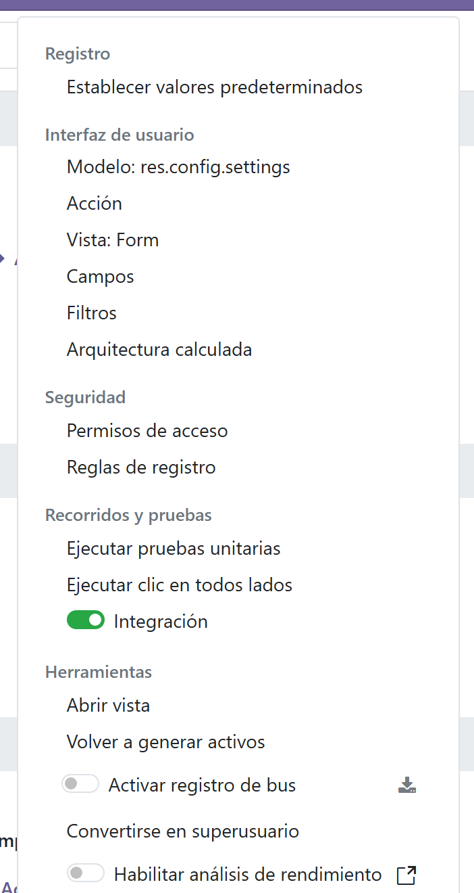

Ya tenés modelos con lógica, así que ya tenés cosas que fallan. Esta lección es sobre el ciclo de trabajo: qué recarga solo, qué no, y cómo parar la ejecución en el punto exacto donde querés mirar.

## Qué recarga solo y qué no

Esta tabla es la que conviene memorizar, porque la mitad de las confusiones salen de acá:

| Cambiaste | Qué hace falta |
|---|---|
| Una vista XML | nada, con `--dev=xml`: recargás el navegador |
| Código Python | reiniciar el servidor |
| Un campo nuevo en un modelo | reiniciar **y** `-u service_workshop` |
| Un archivo de la lista `data` | `-u service_workshop` |
| El manifest | `-u service_workshop` |
| Un archivo de seguridad | `-u service_workshop` |

La regla de fondo: **`-u` es necesario cada vez que cambia algo que Odoo guardó en la base**. Los campos están en la base (como columnas), los datos XML están en la base (como registros), las vistas están en la base.

Las vistas también, pero `--dev=xml` hace que Odoo las relea del archivo en vez de la base. Por eso son la excepción.

## Las opciones de `--dev`

```bash Terminal
./odoo-bin -c odoo.conf --dev=xml,reload,werkzeug
```

- **`xml`** — recarga las vistas desde el archivo. La que más vas a usar.
- **`reload`** — reinicia el servidor cuando cambia un `.py`.
- **`werkzeug`** — muestra el depurador interactivo en el navegador cuando algo explota.
- **`qweb`** — habilita `t-debug` en las plantillas.
- **`all`** — todas.

### `reload` necesita `watchdog`

Ya lo vimos en la sección de entorno, y lo repito acá porque es donde duele: **si no tenés instalado `watchdog` o `inotify`, `--dev=reload` no hace nada y no avisa.**

La forma de saberlo es el log al arrancar:

```text Log de Odoo · Solo aparece si el paquete está
AutoReload watcher running with inotify
```

Sin esa línea, estás esperando un reinicio que nunca va a llegar.

## `_logger`: el método más rápido que hay

No subestimes imprimir cosas. Para «¿qué tiene esta variable acá?», es más rápido que cualquier debugger.

```python models/service_order.py
import logging

_logger = logging.getLogger(__name__)


def entregar(self):
    _logger.info("entregar() con %s órdenes: %s", len(self), self.ids)
    for order in self:
        _logger.info("  %s estado=%s total=%s", order.code, order.state, order.amount_total)
```

Y para ver solo lo tuyo sin ahogarte en el resto:

```bash Terminal
./odoo-bin -c odoo.conf --log-handler=odoo.addons.service_workshop:DEBUG
```

Usá `_logger` y no `print()`. `print` va a la salida estándar, se pierde cuando Odoo corre como servicio, no lleva marca de tiempo ni nivel, y nadie lo filtra. Y tarde o temprano uno se olvida en producción.

## Breakpoints

```python
def entregar(self):
    breakpoint()
    for order in self:
        ...
```

`breakpoint()` es Python estándar desde la 3.7 y para la ejecución ahí. El servidor queda esperando **en la terminal donde lo arrancaste**, y la petición del navegador se queda colgada hasta que sigas.

Los comandos básicos del depurador: `n` pasa a la siguiente línea, `s` entra en la función, `c` continúa, `p variable` imprime, `pp` imprime bonito, `l` muestra el código alrededor, `q` sale.

Lo que hace que esto sea potente en Odoo es que **adentro tenés todo el ORM vivo**:

```text En el depurador
(Pdb) p self
service.order(1, 2)
(Pdb) p self.mapped("state")
['ready', 'draft']
(Pdb) p self.env.user.name
'Mitchell Admin'
(Pdb) p self.env["res.partner"].search_count([])
73
```

Podés consultar, probar dominios y verificar suposiciones sin salir.

### Dos condiciones

**`workers = 0`.** Con varios procesos no sabés cuál atendió la petición, y el depurador aparece en una terminal que no estás mirando. Por eso el `odoo.conf` de desarrollo lo tiene en cero.

**Con Docker, necesitás una terminal interactiva.** Un `docker compose up -d` no te deja entrar al depurador. Para usarlo, levantá el servicio en primer plano con `docker compose run --rm --service-ports odoo`.

## `odoo shell` para explorar

Para «¿qué devuelve esto?», el shell es más rápido que poner un breakpoint y provocar la situación desde el navegador:

```bash Terminal
./odoo-bin shell -c odoo.conf -d taller
```

```python
>>> orders = env["service.order"].search([("state", "=", "ready")])
>>> orders.mapped("partner_id.name")
['Cliente de prueba']
>>> orders._compute_amount_total()
>>> orders.amount_total
570.0
```

Acordate de lo de la lección anterior: **el shell no hace commit solo**. Si querés conservar algo, `env.cr.commit()`.

## Leer un traceback de Odoo

Los tracebacks de Odoo son largos porque incluyen todas las capas del servidor web y del ORM. La técnica es simple:

**Leelo de abajo hacia arriba y buscá la primera línea que mencione tu módulo.**

```text Traceback · Lo que importa es la línea de tu addon
  File ".../odoo/api.py", line 461, in call_kw
  File ".../odoo/models.py", line 4234, in write
  File ".../extra-addons/service_workshop/models/service_order.py", line 88, in write
    raise UserError(...)
odoo.exceptions.UserError: La orden TAL/0007 ya fue entregada...
```

Las primeras líneas son el camino hasta tu código. La última es el error. La que tiene tu ruta es donde mirar.

## Los errores que vas a ver y qué significan

| Mensaje | Casi siempre es |
|---|---|
| `Expected singleton: service.order(1, 2)` | usaste `self.campo` sin iterar |
| `Field 'x' does not exist` | typo en una vista, o te falta `-u` |
| `KeyError: 'service.order'` | el modelo no está cargado: revisá el `__init__.py` |
| `psycopg2.errors.UndefinedColumn` | agregaste un campo y no corriste `-u` |
| `Invalid field 'x' in leaf` | dominio con un campo que no existe o no está almacenado |
| `AccessError` | falta la línea en `ir.model.access.csv` |

Los dos de la mitad son los que más tiempo hacen perder, y los dos se arreglan igual: **corré `-u`**.

## Las herramientas del modo desarrollador

Con el modo desarrollador activo aparece el ícono de bicho en la barra:



De todo lo que ofrece, estos tres son los que vas a usar:

- **Ver campos** — qué campos tiene el modelo de esta pantalla, con su tipo y si están almacenados.
- **Ver vista** — qué XML está generando lo que ves, incluyendo las herencias aplicadas. Es lo que usás cuando tu herencia de vista «no aparece».
- **Ajustes técnicos** — los modelos, las acciones, las secuencias y los trabajos programados, todos editables.

> **Quedate con esto**
> `-u` cada vez que cambies algo que vive en la base: campos, datos, seguridad, manifest. Las vistas son la excepción si corrés con `--dev=xml`. Para mirar valores, `_logger` o el shell; para entender un flujo, `breakpoint()` con `workers = 0`. Y en un traceback, buscá la primera línea que nombre tu módulo.
