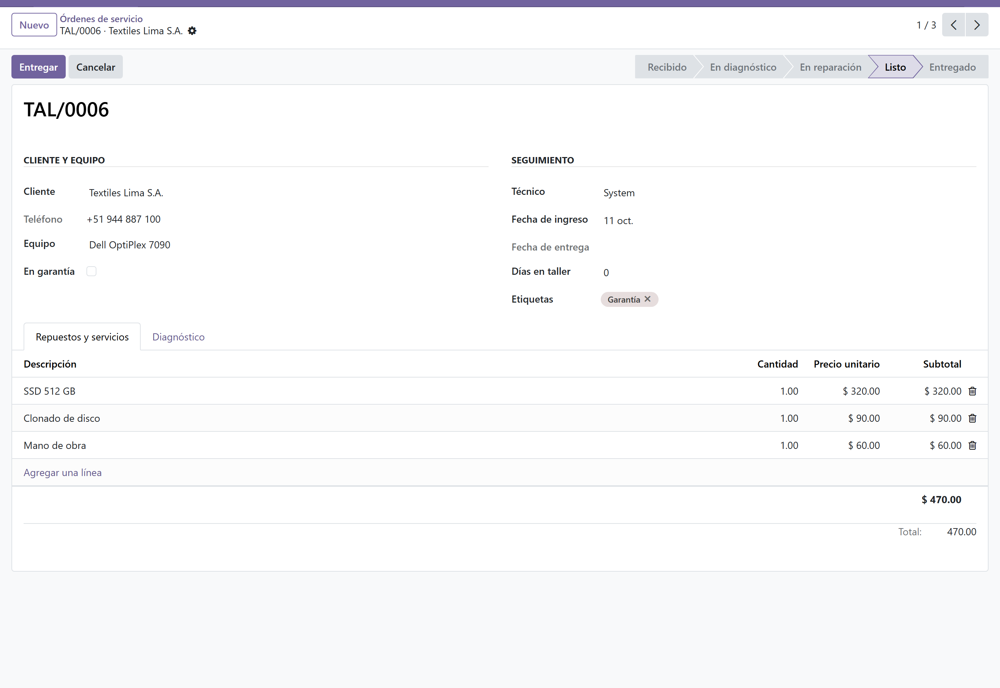

Abrí una factura, un pedido de venta o un albarán en Odoo. Los tres se ven igual: una barra arriba con botones y el estado, un título grande, dos columnas de campos, pestañas abajo.

No es casualidad. Es **el patrón documental**, y conviene seguirlo: el usuario ya sabe usarlo.

Esto es lo que vamos a construir en esta lección:


*Fijate que solo se ve el botón «Entregar»: el estado es «Listo», y los demás botones están ocultos por condición.*

## La estructura completa

```xml views/service_order_views.xml
<record id="view_service_order_form" model="ir.ui.view">
    <field name="name">service.order.form</field>
    <field name="model">service.order</field>
    <field name="arch" type="xml">
        <form string="Orden de servicio">
            <header>
                <button name="action_diagnose" type="object" string="Diagnosticar"
                        class="btn-primary" invisible="state != 'draft'"/>
                <button name="action_approve" type="object" string="Aprobar"
                        class="btn-primary" invisible="state != 'diagnosis'"/>
                <button name="action_deliver" type="object" string="Entregar"
                        class="btn-primary" invisible="state != 'ready'"/>
                <button name="action_cancel" type="object" string="Cancelar"
                        invisible="state in ['done', 'cancel']"/>
                <field name="state" widget="statusbar"
                       statusbar_visible="draft,diagnosis,repair,ready,done"/>
            </header>

            <sheet>
                <div class="oe_title">
                    <h1><field name="code" readonly="1"/></h1>
                </div>

                <group>
                    <group string="Cliente y equipo">
                        <field name="partner_id"/>
                        <field name="partner_phone"/>
                        <field name="equipment_id"/>
                        <field name="is_warranty"/>
                    </group>
                    <group string="Seguimiento">
                        <field name="user_id"/>
                        <field name="date_in"/>
                        <field name="date_done" readonly="1"/>
                        <field name="days_in_shop"/>
                        <field name="tag_ids" widget="many2many_tags"/>
                    </group>
                </group>

                <notebook>
                    <page string="Repuestos y servicios" name="lines">
                        <field name="line_ids">
                            <list editable="bottom">
                                <field name="name"/>
                                <field name="quantity"/>
                                <field name="price_unit"/>
                                <field name="subtotal" sum="Total"/>
                                <field name="currency_id" column_invisible="1"/>
                            </list>
                        </field>
                        <group class="oe_subtotal_footer">
                            <field name="amount_total"/>
                        </group>
                    </page>
                    <page string="Diagnóstico" name="diagnosis">
                        <field name="diagnosis" placeholder="Qué se encontró al revisar el equipo..."/>
                    </page>
                </notebook>
            </sheet>
        </form>
    </field>
</record>
```

Vamos parte por parte.

## `<header>`: botones y estado

Todo lo que va en `<header>` se dibuja en una barra sobre el documento. Los botones a la izquierda, el estado a la derecha.

```xml
<button name="action_approve" type="object" string="Aprobar" class="btn-primary"/>
```

- **`type="object"`** — llama a un método del modelo con ese nombre. Es el que vas a usar casi siempre.
- **`type="action"`** — ejecuta una acción, referenciada por su identificador externo.
- **`class="btn-primary"`** — lo pinta como acción principal. **Un solo botón primario a la vez**: es el que le dice al usuario qué se espera que haga ahora.

El método que invoca es uno común del modelo:

```python models/service_order.py
def action_approve(self):
    self.ensure_one()
    self.state = "approved"
```

Fijate el `ensure_one()` de la lección de recordsets: un botón de formulario siempre actúa sobre un registro.

## `statusbar`: el flujo a la vista

```xml
<field name="state" widget="statusbar" statusbar_visible="draft,diagnosis,repair,ready,done"/>
```

Dibuja el `Selection` como una línea de etapas. **`statusbar_visible` decide cuáles se muestran siempre**: los que no están en esa lista solo aparecen si el registro está en ese estado.

Por eso `cancel` y `approved` quedaron afuera: «Cancelado» no es un paso del flujo normal y ensucia la barra si se muestra siempre.

Agregando `clickable="1"` el usuario puede saltar de etapa clickeando. Para un flujo con reglas, mejor no: que pase por los botones, que son los que validan.

## `<sheet>` y el título

`<sheet>` es lo que le da la apariencia de hoja de papel: fondo blanco, centrado, con sombra. Todo el contenido del documento va adentro.

```xml
<div class="oe_title">
    <h1><field name="code" readonly="1"/></h1>
</div>
```

`oe_title` es la clase que Odoo usa para el identificador grande arriba a la izquierda. El `readonly="1"` es porque el código lo pone la secuencia, no el usuario.

## `<group>`: las dos columnas

```xml
<group>
    <group string="Cliente y equipo">...</group>
    <group string="Seguimiento">...</group>
</group>
```

Un `<group>` que contiene dos `<group>` da **dos columnas**. Cada uno interno es una columna con su título opcional.

Adentro de un grupo, cada `<field>` se dibuja con su etiqueta a la izquierda y el valor a la derecha, alineados. **No pongas campos sueltos fuera de un grupo**: quedan sin alinear y se nota.

Si querés tres columnas, `<group col="3">`.

## `<notebook>`: las pestañas

```xml
<notebook>
    <page string="Repuestos y servicios" name="lines">...</page>
    <page string="Diagnóstico" name="diagnosis">...</page>
</notebook>
```

Para lo que no entra en la vista principal: las líneas del documento, notas, configuración avanzada.

El atributo **`name` no es decorativo**: es lo que vas a usar para engancharte desde otro módulo con una herencia de vista. Ponelo siempre, aunque hoy no lo necesites.

## La lista editable adentro del formulario

```xml
<field name="line_ids">
    <list editable="bottom">
        ...
    </list>
</field>
```

Un One2many dentro de un formulario se dibuja con su propia vista, declarada ahí mismo. Eso es una **vista embebida**.

**`editable="bottom"`** es la diferencia entre usable e insufrible: permite editar las filas en el lugar y agregar nuevas al final. Sin eso, cada línea abre un diálogo aparte.

Y el campo de moneda:

```xml
<field name="currency_id" column_invisible="1"/>
```

Un campo `Monetary` **necesita su moneda presente en la vista** para saber cómo formatear. Si no la incluís, el importe sale mal o directamente no se ve. `column_invisible="1"` la trae sin ocupar una columna.

Es una de esas cosas que no se deducen y hacen perder media hora.

## Condicionales: la sintaxis cambió

```xml
<button name="action_approve" invisible="state != 'diagnosis'"/>
<field name="date_done" readonly="state != 'done'"/>
<field name="diagnosis" required="state in ['approved', 'repair']"/>
```

Los tres atributos dinámicos son `invisible`, `readonly` y `required`, y el valor es **una expresión Python evaluada sobre el registro**.

Podés usar los campos del formulario, operadores normales, `in`, `not in`, `and`, `or`.

> **Si venís de versiones anteriores**
> Esto se escribía con `attrs`, un diccionario de dominios: `attrs="{'invisible': [('state', '!=', 'diagnosis')]}"`. **En Odoo 19 `attrs` ya no existe** — cero apariciones en las vistas del core, frente a casi seis mil condicionales con la sintaxis directa. Si copiás una vista de un tutorial viejo, esto es lo segundo que vas a tener que traducir, después de `<tree>`.

Para que un campo pueda usarse en una condición **tiene que estar en la vista**. Si no querés mostrarlo, incluilo con `invisible="1"` y ya está disponible para las expresiones.

## El pie de totales

```xml
<group class="oe_subtotal_footer">
    <field name="amount_total"/>
</group>
```

`oe_subtotal_footer` es la clase que alinea el total a la derecha, debajo de las líneas, como en las facturas. Es un detalle de dos palabras que hace que el documento se vea como los de Odoo y no como un formulario cualquiera.

## Enganchar la vista a la acción

No hace falta hacer nada: la acción ya tenía `view_mode="list,form"`, y Odoo toma **la vista de cada tipo que tenga menor `priority`** para ese modelo. Con una sola de cada tipo, usa las tuyas.

Si necesitás forzar una vista específica, se hace con `view_ids` en la acción. Lo vemos en la lección de dominios y contexto.

> **Quedate con esto**
> `<header>` con un solo botón primario y el estado en `statusbar`, `<sheet>` con grupos de dos columnas, `<notebook>` con `name` en cada página. Los condicionales ahora se escriben directo —`invisible="state != 'draft'"`—, `attrs` desapareció, y un campo `Monetary` necesita su `currency_id` en la vista aunque sea invisible.
