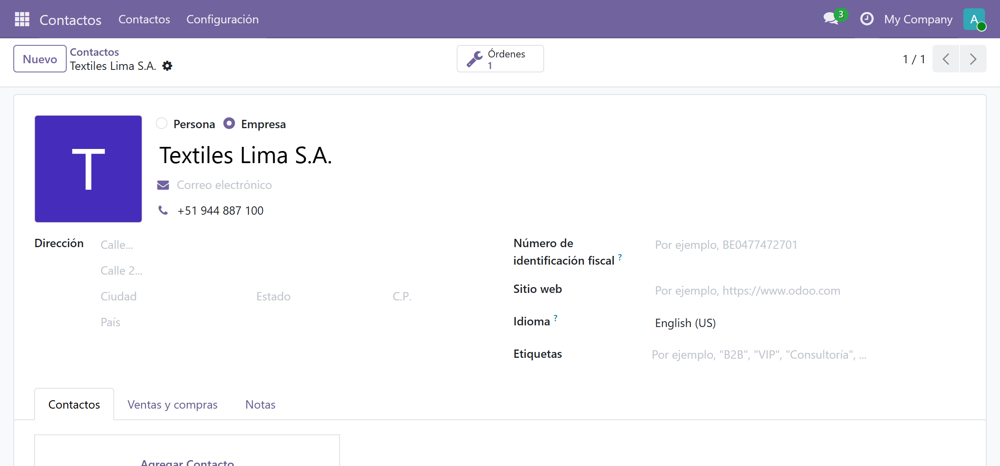

Esta es la lección que explica por qué Odoo es Odoo.

Podés agregarle un campo a `res.partner` —un modelo del core, que no escribiste vos— desde tu módulo, sin tocar un solo archivo de Odoo, y sin que eso rompa las actualizaciones. Todo el ecosistema de módulos existe gracias a esto.

Hay tres mecanismos. Dos se usan todo el tiempo; el tercero casi nunca.

## 1 · `_inherit`: extender un modelo existente

```python models/res_partner.py
from odoo import fields, models


class ResPartner(models.Model):
    _inherit = "res.partner"

    equipment_ids = fields.One2many(
        "service.equipment", "partner_id", string="Equipos"
    )
    service_order_count = fields.Integer(
        string="Órdenes de servicio", compute="_compute_service_order_count"
    )

    def _compute_service_order_count(self):
        for partner in self:
            partner.service_order_count = self.env["service.order"].search_count(
                [("partner_id", "=", partner.id)]
            )
```

Sin `_name`, solo `_inherit`. Eso significa: **no estoy creando un modelo nuevo, estoy modificando `res.partner`**.


*El botón «Órdenes» no existe en Odoo: lo puso nuestro módulo sin tocar una línea del formulario original.*

Lo que pasa en la base es que tus campos se agregan **a la misma tabla `res_partner`**. No hay tabla nueva, no hay join. Para el resto de Odoo, `res.partner` simplemente tiene dos campos más.

Y una vez que hiciste esto, `partner.equipment_ids` funciona **en todo el sistema**: en ventas, en contabilidad, en cualquier módulo que tenga un partner a mano.

### Modificar un campo que ya existe

No hace falta redeclararlo entero. Los atributos se modifican de a uno:

```python
class ResPartner(models.Model):
    _inherit = "res.partner"

    ref = fields.Char(tracking=True)
```

Eso le agrega `tracking` al campo `ref` de Odoo y **deja todos los demás atributos intactos** — su `string`, su `help`, su `index`. La modificación es incremental, no un reemplazo.

### Extender un método: el `super()` que no podés olvidar

```python
def write(self, vals):
    res = super().write(vals)
    # tu lógica acá
    return res
```

Esto es distinto de los campos. **Un método definido en la clase que hereda reemplaza al del padre.** Si no llamás a `super()`, la versión original no corre nunca, y te llevaste puesto todo lo que hacía.

Se profundiza en la sección de recordsets, pero la regla es simple: **salvo que sepas exactamente por qué no, llamá a `super()`**.

## 2 · `_inherits`: delegación, con la «s» que cambia todo

Con una sola letra de diferencia, el comportamiento es completamente otro.

`_inherits` sirve cuando querés un modelo nuevo que **sea** otro modelo más campos propios. El ejemplo que ya tenés instalado es `res.users`:

```python Odoo core · así está definido res.users
class Users(models.Model):
    _name = "res.users"
    _inherits = {"res.partner": "partner_id"}
```

Un usuario **es** un partner con credenciales. Y por eso pasa algo que confunde a todo el mundo la primera vez: `res.users` no tiene columna `lang`, ni `email`, ni `phone`. Esas viven en `res_partner`. Si escribís `user.email`, el ORM lo resuelve solo, pero si hacés un `UPDATE` directo contra `res_users` buscando esa columna, no existe.

La sintaxis es un diccionario: **modelo padre → campo Many2one que lo apunta**. Odoo crea y mantiene ese Many2one por vos, y cuando creás un usuario, crea el partner detrás automáticamente.

En la base son **dos tablas** con un join. No se duplica ni un dato.

Cuándo usarlo: cuando tu modelo necesita *todos* los campos de otro y además es, conceptualmente, una especialización de ese otro. Un socio de biblioteca es una persona. Un empleado es una persona. Un usuario es una persona.

Cuándo **no** usarlo: cuando solo necesitás algunos campos. Para eso está el Many2one normal. La delegación te ata a todo el modelo padre.

## 3 · Prototipo: `_name` y `_inherit` juntos

```python
class ServiceOrderArchive(models.Model):
    _name = "service.order.archive"
    _inherit = "service.order"
```

Esto **copia la definición** de `service.order` en un modelo nuevo, con su propia tabla y sus propios datos, completamente independiente.

Lo menciono para que lo reconozcas si lo ves, no para que lo uses. En la práctica casi nunca es lo que querés: duplicás la estructura, y cualquier cambio futuro en el padre te llega sin que lo pidas. Casi siempre la respuesta correcta es delegación.

Un detalle que ahorra un rato de confusión: **si ponés el mismo nombre en `_name` y en `_inherit`, no copia nada** — se comporta como una extensión normal.

## Modelos abstractos: el mixin propio

Un `AbstractModel` **no tiene tabla**. Existe solo para que otros modelos lo hereden.

Es la forma de escribir una vez algo que varios modelos necesitan. En el taller, por ejemplo, la numeración automática:

```python models/service_sequence_mixin.py
from odoo import api, fields, models


class ServiceSequenceMixin(models.AbstractModel):
    _name = "service.sequence.mixin"
    _description = "Numeración automática por secuencia"

    code = fields.Char(string="Código", required=True, copy=False, readonly=True, default="Nuevo")

    def _sequence_code(self):
        """Cada modelo que use el mixin declara su secuencia."""
        raise NotImplementedError

    @api.model_create_multi
    def create(self, vals_list):
        for vals in vals_list:
            if vals.get("code", "Nuevo") == "Nuevo":
                vals["code"] = self.env["ir.sequence"].next_by_code(self._sequence_code()) or "Nuevo"
        return super().create(vals_list)
```

Y usarlo:

```python models/service_order.py
class ServiceOrder(models.Model):
    _name = "service.order"
    _inherit = ["service.sequence.mixin"]
    _description = "Orden de servicio"

    def _sequence_code(self):
        return "service.order"
```

Fijate que `_inherit` **acepta una lista**. Un modelo puede heredar de varios mixins, y es exactamente así como vas a sumar el chatter más adelante:

```python
_inherit = ["service.sequence.mixin", "mail.thread", "mail.activity.mixin"]
```

`mail.thread` y `mail.activity.mixin` son modelos abstractos del core. Cuando los agregues, tu modelo gana historial, seguidores y actividades sin que escribas una línea.

## El orden de resolución

Con `_inherit = ["a", "b"]` y además la clase propia, Python resuelve los métodos en el orden habitual de su MRO: **la clase propia primero, después los mixins de derecha a izquierda**.

En la práctica importa poco, salvo cuando dos mixins definen el mismo método. Si eso te pasa, la salida sana es llamar explícitamente al que querés en vez de pelearte con el orden.

## Una trampa que vas a pisar

Extender un modelo de otro módulo **exige declararlo en `depends`**.

```python __manifest__.py
"depends": ["base"],
```

Si heredás `res.partner`, necesitás `base`. Si heredás `sale.order`, necesitás `sale`. Sin esa declaración, el orden de carga no está garantizado: tu módulo puede cargarse antes que el otro, y el modelo que querés extender todavía no existe.

El error que vas a ver habla de un modelo inexistente y no menciona `depends` por ningún lado.

## Dónde quedó el módulo

Con esta lección cerramos la sección de ORM. `service_workshop` ya tiene:

- `service.order` con sus campos, relaciones, calculados y restricciones.
- `service.order.line`, las líneas.
- `service.equipment` y su categoría jerárquica.
- `service.tag`, para etiquetar.
- `res.partner` extendido con los equipos del cliente.
- Un mixin de numeración reutilizable.

Todo eso existe en la base de datos y **no se puede ver desde ninguna pantalla todavía**. Eso lo arregla la próxima sección.

> **Quedate con esto**
> `_inherit` modifica un modelo existente en su misma tabla, `_inherits` crea uno nuevo que delega en otro con un join, y los `AbstractModel` son mixins sin tabla. Para los campos, la herencia es incremental; para los métodos, reemplaza — y ahí es donde `super()` deja de ser opcional.
