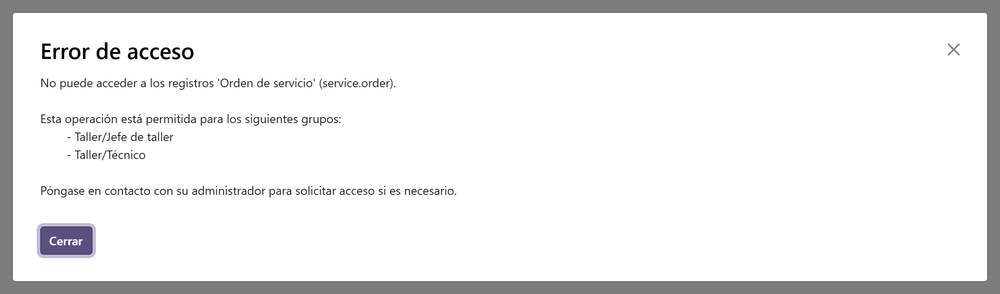

Este archivo lo pusimos en la sección de vistas sin explicarlo, porque sin él el módulo no se puede abrir. Ahora toca entenderlo.

Es el archivo más aburrido de Odoo y el que más tiempo hace perder cuando falta una línea.

## El formato

```csv security/ir.model.access.csv
id,name,model_id:id,group_id:id,perm_read,perm_write,perm_create,perm_unlink
access_service_order_tech,service.order técnico,model_service_order,service_workshop.group_service_technician,1,1,1,0
access_service_order_mgr,service.order jefe,model_service_order,service_workshop.group_service_manager,1,1,1,1
access_service_order_line_tech,service.order.line técnico,model_service_order_line,service_workshop.group_service_technician,1,1,1,1
access_service_equipment_tech,service.equipment técnico,model_service_equipment,service_workshop.group_service_technician,1,1,1,0
access_service_equipment_mgr,service.equipment jefe,model_service_equipment,service_workshop.group_service_manager,1,1,1,1
access_service_equipment_category_tech,categorías técnico,model_service_equipment_category,service_workshop.group_service_technician,1,0,0,0
access_service_equipment_category_mgr,categorías jefe,model_service_equipment_category,service_workshop.group_service_manager,1,1,1,1
access_service_tag_tech,etiquetas técnico,model_service_tag,service_workshop.group_service_technician,1,0,0,0
access_service_tag_mgr,etiquetas jefe,model_service_tag,service_workshop.group_service_manager,1,1,1,1
```

Es un CSV normal que carga registros en el modelo `ir.model.access`. Nada mágico: podrías escribirlo en XML, pero con una línea por modelo y por grupo el CSV es mucho más compacto.

## Columna por columna

**`id`** — el identificador externo de esa línea. Tiene que ser único en el módulo. La convención es `access_<modelo>_<grupo>`.

**`name`** — un texto descriptivo. Aparece en Ajustes → Técnico → Reglas de acceso, que es donde vas a mirar cuando algo no cierre.

**`model_id:id`** — **acá está la trampa**. Es el identificador externo del modelo, y se construye con `model_` más el nombre del modelo **con los puntos convertidos en guiones bajos**:

```text
service.order            →  model_service_order
service.equipment.category →  model_service_equipment_category
res.partner              →  model_res_partner
```

Para un modelo de otro módulo hay que anteponer su módulo: `base.model_res_partner`.

Ese identificador lo genera Odoo solo para cada modelo que declarás. No lo escribís en ningún lado: existe porque tu modelo existe.

**`group_id:id`** — el identificador externo del grupo, con el prefijo del módulo. **Si lo dejás vacío, la regla aplica a todos los usuarios**, incluidos los de portal y los públicos. Es casi nunca lo que querés.

**`perm_read` / `perm_write` / `perm_create` / `perm_unlink`** — `1` o `0`. Leer, modificar, crear, borrar.

## Qué pasa si no hay ninguna línea

**Nada funciona.** Esto es lo que ve el usuario:


*Odoo te dice exactamente qué modelo y qué grupos lo permiten. Con eso vas derecho al CSV.*

Hay una excepción que confunde: **el superusuario se saltea todo esto**. Si estás probando con un usuario que tiene el flag de superusuario activo, todo funciona y no detectás el problema.

Por eso la regla práctica: **probá siempre con un usuario normal**. Ajustes → Usuarios → creá uno con solo el grupo que querés probar y entrá con él. Es la única forma de ver lo que ven los demás.

## Cómo decidir los permisos

El criterio que suelo aplicar:

**Casi nadie necesita `perm_unlink`.** Borrar documentos de negocio es destruir historia. Para sacarlos de la vista están el estado «cancelado» y el archivado. Fijate que al técnico le dimos `0` en borrado de órdenes.

**Las líneas sí se borran.** Quitar una línea de repuesto de una orden es una operación normal, y el One2many necesita poder borrar para que el usuario pueda sacar filas en el formulario. Por eso `access_service_order_line_tech` tiene `perm_unlink` en `1`.

Esa asimetría —no podés borrar la orden pero sí sus líneas— es correcta, y es un error común ponerle `0` a las líneas y después no entender por qué el botón de la papelera no funciona.

**Los catálogos se leen, no se escriben.** El técnico lee categorías y etiquetas; el jefe las administra. Por eso el técnico tiene `1,0,0,0`.

## Varias líneas para el mismo modelo

Los permisos de un usuario son **la unión de todos los grupos a los que pertenece**. Si una línea le da lectura y otra escritura, tiene las dos.

**No existe la denegación.** No podés escribir una línea que *quite* un permiso que otra dio. Si necesitás que alguien tenga menos, es que no debería estar en ese grupo.

Esto cambia cómo se diseña: se construye **sumando**, del perfil más básico al más amplio. El técnico tiene lo mínimo, el jefe implica al técnico y suma lo suyo.

## Los modelos transitorios

Los wizards —que vemos en la próxima sección— también necesitan su línea:

```csv
access_service_close_wizard,cerrar órdenes,model_service_close_wizard,service_workshop.group_service_technician,1,1,1,0
```

Es uno de los olvidos más frecuentes: hacés el asistente, lo abrís y recibís un error de acceso sobre un modelo que ni sabías que tenía permisos.

## Cuando falla, cómo leerlo

El mensaje te dice tres cosas:

```text
No tiene permiso para acceder a los registros de 'Orden de servicio' (service.order).
Esta operación es: lectura
```

**El modelo** y **la operación**. Con eso vas al CSV y buscás si hay una línea para ese modelo y alguno de los grupos del usuario, con un `1` en esa columna.

Y si agregaste la línea y sigue fallando: **¿corriste `-u`?** El CSV vive en la base, como todo lo demás.

## Una herramienta que ahorra tiempo

Con el modo desarrollador: **Ajustes → Técnico → Seguridad → Reglas de acceso**. Filtrás por modelo y ves todas las líneas cargadas, de todos los módulos, con sus grupos y permisos.

Es la forma rápida de verificar qué quedó realmente, en vez de leer CSV.

> **Quedate con esto**
> El `model_id:id` se arma con `model_` más el nombre del modelo con guiones bajos; ahí se equivoca todo el mundo la primera vez. Los permisos se suman entre grupos y **no existe la denegación**, así que se diseña de menos a más. Y probá siempre con un usuario normal: el superusuario no ve ninguno de estos errores.
