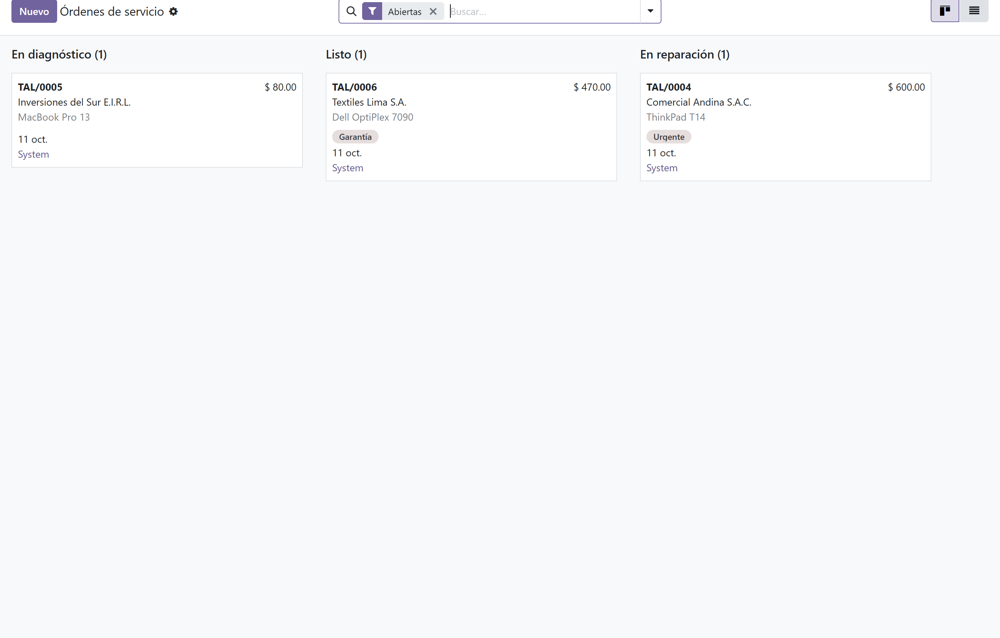

Una lista responde «qué hay». Un kanban responde «cómo viene la cosa». Para un taller, donde el trabajo pasa por etapas, el kanban **es** la pantalla principal.


*El filtro «Abiertas» ya viene activo: es el `search_default_abiertas` de la lección anterior, puesto en el contexto de la acción.*

## El kanban

```xml views/service_order_views.xml
<record id="view_service_order_kanban" model="ir.ui.view">
    <field name="name">service.order.kanban</field>
    <field name="model">service.order</field>
    <field name="arch" type="xml">
        <kanban default_group_by="state" quick_create="0">
            <field name="state"/>
            <field name="amount_total"/>
            <field name="currency_id"/>
            <templates>
                <t t-name="card">
                    <div class="o_kanban_record_top">
                        <strong class="o_kanban_record_title">
                            <field name="code"/>
                        </strong>
                        <span class="float-end">
                            <field name="amount_total" widget="monetary"/>
                        </span>
                    </div>
                    <div class="o_kanban_record_body">
                        <field name="partner_id"/><br/>
                        <span class="text-muted"><field name="equipment_id"/></span>
                        <div class="mt-2">
                            <field name="tag_ids" widget="many2many_tags"/>
                        </div>
                    </div>
                    <div class="o_kanban_record_bottom">
                        <div class="oe_kanban_bottom_left">
                            <field name="date_in"/>
                        </div>
                        <div class="oe_kanban_bottom_right">
                            <field name="user_id" widget="many2one_avatar_user"/>
                        </div>
                    </div>
                </t>
            </templates>
        </kanban>
    </field>
</record>
```

La tarjeta es **una plantilla QWeb**, el motor de plantillas de Odoo. Lo vemos en profundidad en la lección de reportes; por ahora alcanza con saber que `<field>` adentro de la plantilla imprime el valor.

Tres cosas que no son obvias:

**Los `<field>` sueltos arriba de `<templates>`** declaran qué datos traer. Si usás un campo solo en una condición y no lo imprimís, igual tiene que estar declarado ahí o no va a estar disponible.

**`default_group_by="state"`** es lo que convierte el kanban en un tablero de columnas. Sin eso es una grilla de tarjetas sin más.

**Arrastrar una tarjeta escribe el campo de agrupación.** Mover una orden de «En reparación» a «Listo» hace un `write({"state": "ready"})`. Pasa por tu `write` y por tus restricciones, así que la validación sigue valiendo.

## Etapas: `Selection` o modelo propio

Agrupamos por `state`, que es un `Selection`. Es simple y funciona, pero tiene un límite: **las etapas están en el código**. Agregar una exige tocar Python y actualizar el módulo.

La alternativa es un modelo de etapas:

```python models/service_stage.py
class ServiceStage(models.Model):
    _name = "service.stage"
    _description = "Etapa del taller"
    _order = "sequence, id"

    name = fields.Char(required=True)
    sequence = fields.Integer(default=10)
    fold = fields.Boolean(string="Plegada en kanban")
    is_closing = fields.Boolean(string="Cierra la orden")
```

Así el usuario administra sus propias etapas. Es lo que hace Odoo en CRM y en Proyecto, y la razón es funcional: cada empresa tiene su flujo.

El `fold` sirve para que las columnas terminales —«Entregado», «Cancelado»— aparezcan plegadas y no ocupen media pantalla con cientos de tarjetas.

**Cuál elegir**: si el flujo es fijo y hay lógica atada a cada etapa, `Selection`. Si el usuario necesita cambiarlo, modelo propio. Para el taller, `Selection` alcanza.

### Columnas vacías

Con un `Selection`, Odoo muestra todas las opciones como columnas aunque estén vacías. Con un modelo de etapas no: solo aparecen las que tienen registros, y eso rompe la sensación de tablero.

Se arregla con `group_expand`:

```python models/service_order.py
@api.model
def _group_expand_stage(self, stages, domain):
    return stages.search([], order="sequence")

stage_id = fields.Many2one("service.stage", group_expand="_group_expand_stage")
```

## La barra de progreso

```xml
<kanban default_group_by="state">
    <progressbar field="activity_state"
                 colors='{"planned": "success", "today": "warning", "overdue": "danger"}'/>
    ...
</kanban>
```

Agrega sobre cada columna una barra que parte las tarjetas por el valor de un campo. Clickeando un tramo se filtra.

Para el taller es más útil con un campo propio, por ejemplo un semáforo de demora.

## Calendar

```xml
<record id="view_service_order_calendar" model="ir.ui.view">
    <field name="name">service.order.calendar</field>
    <field name="model">service.order</field>
    <field name="arch" type="xml">
        <calendar date_start="date_in" color="user_id" mode="month" quick_create="0">
            <field name="partner_id"/>
            <field name="equipment_id"/>
        </calendar>
    </field>
</record>
```

- **`date_start`** y opcionalmente `date_stop` — qué campos ubican el evento.
- **`color`** — un campo por el que colorear. Odoo asigna un color por valor, así que cada técnico tiene el suyo.
- **`mode`** — `day`, `week`, `month` o `year`.

Arrastrar un evento **escribe el campo de fecha**. Igual que el kanban: pasa por tu `write`.

## Gantt, que es de Enterprise

```xml
<gantt date_start="date_in" date_stop="date_done" default_group_by="user_id"/>
```

Muestra barras en una línea de tiempo, agrupadas. Para ver la carga de cada técnico es exactamente la vista correcta.

**Pero la vista gantt es de Odoo Enterprise.** En Community no existe, y una acción que la pida en su `view_mode` falla.

Lo mismo pasa con `cohort`, `dashboard` y `map`. Si tu módulo tiene que correr en Community, o no las usás, o las ponés en un módulo aparte que dependa del de Enterprise.

Es una de esas cosas que conviene saber antes de diseñar la interfaz y no después.

## Sumar las vistas a la acción

```xml
<field name="view_mode">kanban,list,form,calendar</field>
```

El orden decide cuál abre primero. Para el taller, el kanban adelante tiene sentido: la pregunta diaria es «cómo viene el trabajo», no «dame la lista».

## El botón de estadística

Un extra que encaja acá porque usa lo mismo que venimos viendo. En la ficha del cliente, un botón que muestra cuántas órdenes tiene y lleva a ellas:

```xml views/res_partner_views.xml
<record id="view_partner_form_service" model="ir.ui.view">
    <field name="name">res.partner.form.service</field>
    <field name="model">res.partner</field>
    <field name="inherit_id" ref="base.view_partner_form"/>
    <field name="arch" type="xml">
        <div name="button_box" position="inside">
            <button name="action_view_service_orders" type="object"
                    class="oe_stat_button" icon="fa-wrench">
                <field name="service_order_count" widget="statinfo" string="Órdenes"/>
            </button>
        </div>
    </field>
</record>
```

```python models/res_partner.py
def action_view_service_orders(self):
    self.ensure_one()
    return {
        "type": "ir.actions.act_window",
        "name": "Órdenes de servicio",
        "res_model": "service.order",
        "view_mode": "list,form",
        "domain": [("partner_id", "=", self.id)],
        "context": {"default_partner_id": self.id},
    }
```

Fijate que el método **devuelve una acción como diccionario**. Es la forma de abrir una pantalla desde código, y aparece en todos lados.

Y mirá el par `domain` + `context` de la lección anterior: filtra las del cliente y, si creás una nueva desde ahí, viene con el cliente puesto.

Ese `<div name="button_box" position="inside">` es herencia de vistas, que es justo la próxima lección.

> **Quedate con esto**
> El kanban agrupa por un campo y arrastrar una tarjeta **escribe ese campo**, pasando por tu `write` y tus validaciones. Las etapas como `Selection` son simples pero fijas; como modelo propio las maneja el usuario, a cambio de necesitar `group_expand` para que no desaparezcan las columnas vacías. Y gantt, cohort, dashboard y map son de Enterprise: en Community no existen.
