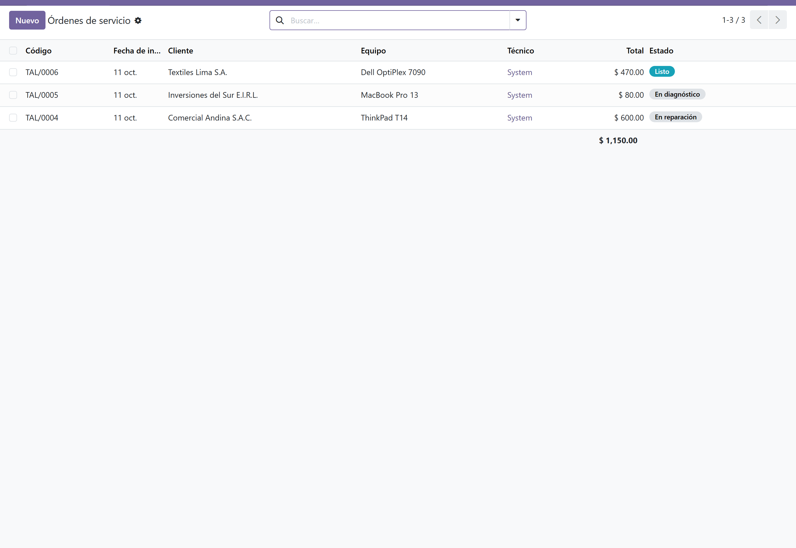

Tenés modelos con datos, relaciones y lógica, y no hay forma de verlos. Esta lección los pone en pantalla.

Para eso hay una cadena de tres eslabones que conviene entender antes de escribirla:

**Menú → Acción → Vista**

El menú es lo que el usuario clickea. La acción dice **qué modelo abrir y cómo**. La vista define **qué se ve**. Son tres registros separados a propósito: así una misma acción se puede abrir desde varios menús, y un modelo puede tener varias vistas.

## Antes: el permiso que te deja abrir todo esto

Hay algo que tenemos que poner ahora aunque se explique dos secciones más adelante. Sin permisos de acceso, **tu modelo no se puede abrir ni siendo administrador** y vas a ver un error en vez de una pantalla.

```csv security/ir.model.access.csv
id,name,model_id:id,group_id:id,perm_read,perm_write,perm_create,perm_unlink
access_service_order_user,service.order user,model_service_order,base.group_user,1,1,1,0
access_service_order_line_user,service.order.line user,model_service_order_line,base.group_user,1,1,1,1
access_service_equipment_user,service.equipment user,model_service_equipment,base.group_user,1,1,1,0
access_service_equipment_category_user,service.equipment.category user,model_service_equipment_category,base.group_user,1,1,1,0
access_service_tag_user,service.tag user,model_service_tag,base.group_user,1,1,1,0
```

Por ahora tomalo como un requisito: una línea por modelo, dándole acceso a todos los usuarios internos. En la sección de seguridad vemos qué significa cada columna y cómo se restringe de verdad.

## La acción

```xml views/service_order_views.xml
<?xml version="1.0" encoding="utf-8"?>
<odoo>
    <record id="action_service_order" model="ir.actions.act_window">
        <field name="name">Órdenes de servicio</field>
        <field name="res_model">service.order</field>
        <field name="view_mode">list,form</field>
        <field name="context">{"search_default_abiertas": 1}</field>
        <field name="help" type="html">
            <p class="o_view_nocontent_smiling_face">
                Registrá la primera orden de servicio
            </p>
            <p>
                Cuando entra un equipo al taller, creás una orden acá.
            </p>
        </field>
    </record>
</odoo>
```

Una acción es **un registro de un modelo de Odoo** (`ir.actions.act_window`), no una etiqueta especial. Eso explica por qué se escribe con `<record>`, como cualquier otro dato.

Los campos que importan:

- **`res_model`** — qué modelo abre.
- **`view_mode`** — qué vistas ofrece y **en qué orden**. La primera es la que se abre. `list,form` significa: abrí la lista, y al clickear una fila andá al formulario.
- **`domain`** — un filtro fijo, que el usuario no puede sacar.
- **`context`** — valores por defecto. Lo vemos en su propia lección.
- **`help`** — lo que se muestra cuando no hay ningún registro. Vale la pena escribirlo: es la primera pantalla que ve alguien que entra al módulo, y un mensaje vacío ahí se siente roto.

## La vista de lista

```xml views/service_order_views.xml
<record id="view_service_order_list" model="ir.ui.view">
    <field name="name">service.order.list</field>
    <field name="model">service.order</field>
    <field name="arch" type="xml">
        <list string="Órdenes de servicio">
            <field name="code"/>
            <field name="date_in"/>
            <field name="partner_id"/>
            <field name="equipment_id"/>
            <field name="user_id" widget="many2one_avatar_user"/>
            <field name="amount_total" sum="Total"/>
            <field name="state" widget="badge"
                   decoration-success="state == 'done'"
                   decoration-info="state == 'ready'"
                   decoration-muted="state == 'cancel'"/>
        </list>
    </field>
</record>
```

Tres cosas de ahí merecen atención.

**`sum="Total"`** agrega una fila de totales al pie de la columna. Gratis, y es de las cosas que más se agradecen en una lista de documentos con importes.

**`widget="badge"`** dibuja el estado como una etiqueta en vez de texto plano. Odoo trae decenas de widgets; vale la pena mirar los que ya usa el core antes de inventar uno.

**`decoration-*`** colorea la fila o el valor según una condición. Las opciones son `success`, `info`, `warning`, `danger`, `muted` y `bf` (negrita). La condición es una expresión Python sobre los campos del registro.

> **Si venís de versiones anteriores**
> El elemento se llamaba `<tree>`. **En Odoo 19 es `<list>`**, y no es un alias amable: en el código fuente de Odoo 19 no queda **ni una sola** vista con `<tree>`. Como prácticamente todo tutorial que vas a encontrar usa el nombre viejo, es el primer error que vas a cometer copiando y pegando.

## Los menús

```xml views/menus.xml
<?xml version="1.0" encoding="utf-8"?>
<odoo>
    <menuitem id="menu_service_root"
              name="Taller"
              sequence="50"
              web_icon="service_workshop,static/description/icon.png"/>

    <menuitem id="menu_service_operations"
              name="Operaciones"
              parent="menu_service_root"
              sequence="10"/>

    <menuitem id="menu_service_order"
              name="Órdenes de servicio"
              parent="menu_service_operations"
              action="action_service_order"
              sequence="10"/>
</odoo>
```

`<menuitem>` sí es una etiqueta de conveniencia: Odoo la traduce a un registro de `ir.ui.menu`.

La jerarquía se arma con `parent`, y hay tres niveles con significados distintos:

- **Raíz sin `action`** — es la aplicación. Aparece en el menú principal de Odoo con su ícono.
- **Intermedio sin `action`** — una sección dentro de la barra superior.
- **Hoja con `action`** — lo clickeable.

**`sequence` ordena** los menús entre hermanos. Número más chico, más arriba. Dejá huecos —10, 20, 30— para poder insertar algo en el medio después sin renumerar todo.

Un menú raíz **sin hijos con acción no se muestra**. Si tu aplicación no aparece, es lo primero que hay que revisar.

## Declararlo en el manifest

Nada de esto existe hasta que lo sumás a la lista `data`, **en orden**:

```python __manifest__.py
"data": [
    "security/ir.model.access.csv",
    "data/service_sequence.xml",
    "views/service_order_views.xml",
    "views/menus.xml",
],
```

Acordate de la regla de la sección de entorno: **los menús van al final**, porque referencian acciones que tienen que existir antes. Si invertís esas dos líneas, la instalación falla diciendo que no encuentra `action_service_order`.

Y la seguridad primero, porque las vistas pueden referenciar grupos.

## Probalo

```bash Terminal
docker compose run --rm odoo odoo -d taller -u service_workshop --stop-after-init
docker compose restart odoo
```

En el menú principal tenés que ver **Taller**. Adentro, Operaciones → Órdenes de servicio:


*Los estados como insignias de color salen de `widget="badge"` y los `decoration-*`; la fila de total al pie, del `sum="Total"`.*

Si no aparece, en este orden:

1. ¿Corriste `-u`? Las vistas y los menús viven en la base.
2. ¿Está el archivo en la lista `data` del manifest?
3. ¿El menú raíz tiene algún hijo con acción?
4. Mirá el log: un error de XML aparece ahí, no en pantalla.

## Los identificadores externos

```xml
<record id="action_service_order" model="ir.actions.act_window">
```

Ese `id` no es una columna de la base: es un **identificador externo**, el nombre con el que tu módulo referencia ese registro. Desde otro archivo lo usás como `service_workshop.action_service_order`, con el prefijo del módulo.

Es lo que permite que `<menuitem action="action_service_order">` encuentre la acción, y lo que hace que actualizar el módulo **modifique** el registro existente en vez de crear uno nuevo cada vez.

Lo vemos entero en la lección de datos del módulo.

> **Quedate con esto**
> Menú, acción y vista son tres registros separados, y el `view_mode` de la acción decide cuál se abre primero. El elemento de la lista es `<list>`, no `<tree>` — ahí vas a tropezar con el 90% de los tutoriales. Y el orden en la lista `data` importa: seguridad arriba, menús al final.
