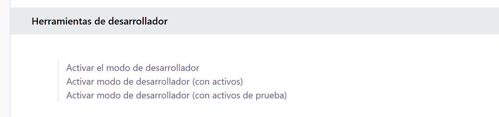

En la lección anterior vimos las cinco piezas que Odoo necesita. Acá las vamos a armar todas de una vez, y vas a poder ver cada una en el archivo.

Si venís de la lección anterior con la duda de cuál de las cinco iba a dar más problemas, la respuesta era wkhtmltopdf. Docker la resuelve sola: **la imagen oficial ya trae la versión correcta compilada**. Esa es la razón principal por la que este curso se sigue con contenedores y no con una instalación a mano.

La otra razón es más importante a largo plazo: el contenedor que usás para desarrollar es el mismo que vas a desplegar. Se acaban las sorpresas del día del despliegue.

## Las cinco piezas, ahora como servicios

Antes de escribir el archivo, mirá el mapeo. Esto es todo lo que vamos a hacer:

| La pieza | Dónde queda |
|---|---|
| PostgreSQL | el servicio `db` |
| Python con sus dependencias | dentro de la imagen `odoo:19` |
| wkhtmltopdf | dentro de la imagen, ya resuelto |
| `addons_path` | un bind mount de tu carpeta + el `odoo.conf` |
| `odoo.conf` | un archivo montado en `/etc/odoo` |

## La estructura de carpetas

```text Tres carpetas y dos archivos
odoo-curso/
├── compose.yaml
├── config/
│   └── odoo.conf
└── addons/          ← acá van a vivir tus módulos
```

## El compose

```yaml compose.yaml · Odoo 19 y PostgreSQL
services:
  db:
    image: postgres:16
    environment:
      POSTGRES_USER: odoo
      POSTGRES_PASSWORD: odoo
      POSTGRES_DB: postgres
    volumes:
      - pgdata:/var/lib/postgresql/data

  odoo:
    image: odoo:19
    depends_on:
      - db
    ports:
      - "8069:8069"
    environment:
      HOST: db
      USER: odoo
      PASSWORD: odoo
    volumes:
      - odoo-data:/var/lib/odoo
      - ./config:/etc/odoo
      - ./addons:/mnt/extra-addons
    command: odoo --dev=xml,qweb

volumes:
  pgdata:
  odoo-data:
```

Hay cuatro decisiones ahí que conviene no copiar a ciegas.

**`POSTGRES_DB: postgres`.** Puede parecer que hay que ponerle el nombre de tu base, pero no. Acordate de la lección anterior: Odoo crea sus propias bases. Para poder crearlas necesita conectarse primero a una base que ya exista, y esa es `postgres`. Si la cambiás, el gestor de bases de Odoo deja de funcionar.

**`HOST`, `USER` y `PASSWORD`.** La imagen oficial lee esas tres variables para armar la conexión. Fijate que `HOST` vale `db`: dentro de la red de Compose, el nombre del servicio es el nombre del host.

**Los dos volúmenes con nombre, no bind mounts.** `pgdata` guarda la base y `odoo-data` guarda el **filestore** —los adjuntos, las imágenes de productos— que, como vimos, no vive en PostgreSQL. Van como volúmenes con nombre a propósito: montar esas carpetas desde el host trae problemas de permisos en Linux y de rendimiento en macOS y Windows. Tu código sí se monta desde el host; los datos de Odoo, no.

**`./addons:/mnt/extra-addons`.** Esa ruta no es arbitraria: `/mnt/extra-addons` **ya está en el `addons_path` por defecto de la imagen oficial**. Si montás ahí, no hace falta configurar nada más para que Odoo encuentre tus módulos.

## El `odoo.conf`

```ini config/odoo.conf · Lo mínimo para desarrollar
[options]
addons_path = /mnt/extra-addons
data_dir = /var/lib/odoo
admin_passwd = cambiala-por-algo-tuyo
db_host = db
db_user = odoo
db_password = odoo
http_port = 8069
workers = 0
log_level = info
```

**`workers = 0`** es deliberado. Con cero workers Odoo corre en un solo proceso, y eso es lo que querés mientras desarrollás: los breakpoints funcionan, los logs salen en orden y no tenés que adivinar qué proceso atendió el pedido. En producción es al revés, pero eso es tema del otro curso.

**`admin_passwd`** es la contraseña maestra del gestor de bases, no la del usuario admin. Cambiala aunque sea tu máquina: te vas a acostumbrar a cambiarla.

## Levantarlo

```bash Terminal · Primera vez
docker compose up -d
docker compose logs -f odoo
```

Cuando en el log veas que el servidor quedó escuchando, andá a `http://localhost:8069`. Te va a recibir la pantalla de creación de base de datos.

Creá una —ponele `taller`— y marcá **«Cargar datos de demostración»**. Durante el curso los datos de demo ayudan: vas a tener clientes y productos con los que probar sin inventarlos a mano.

El usuario que crees ahí es tu administrador. La contraseña maestra que pide es la del `odoo.conf`.

## Activar el modo desarrollador

Sin esto no vas a poder ver los identificadores técnicos, el menú de Ajustes técnicos ni la mitad de las cosas que necesitás.

**Ajustes** → bajá hasta el final de la página → sección **Herramientas de desarrollador**:


*«Con activos» además desactiva la minificación del JavaScript y el CSS; lo vas a necesitar en el curso de OWL, no todavía.*

El atajo, cuando te lo sepas de memoria, es agregar `?debug=1` a la URL. Odoo 19 usa el esquema `/odoo/...`, así que queda `http://localhost:8069/odoo/settings?debug=1`. Para salir, `?debug=0`.

Ojo con esto si seguís tutoriales viejos: hasta hace unas versiones las URLs eran del tipo `/web#action=...` y el parámetro iba **antes** del `#`. Ese esquema ya no existe.

## El ciclo de desarrollo

Esta es la parte que te va a ahorrar horas. Por defecto, cada cambio que hagas en tu módulo exige reiniciar el servidor, y si tocaste un XML, además actualizar el módulo. La opción `--dev` cambia eso.

En el compose dejamos `--dev=xml,qweb`. Esto es lo que hace cada valor:

- **`xml`** — cambiás una vista, recargás el navegador y la ves. Sin reiniciar, sin actualizar el módulo. Es el que más vas a agradecer.
- **`qweb`** — habilita el atributo `t-debug` en las plantillas QWeb.
- **`reload`** — recarga el servidor solo cuando cambia un archivo Python.
- **`werkzeug`** — muestra el depurador interactivo en el navegador cuando algo explota, en vez de tragarse la excepción.
- **`all`** — todos los anteriores.

### Por qué no puse `--dev=all`

Porque `reload` **necesita que esté instalado `inotify` o `watchdog`**, y si no están, no recarga nada y tampoco te avisa. Te quedás esperando un reinicio que nunca llega y culpando a tu código.

La forma de saber si lo tenés es mirar el log al arrancar. Si la recarga automática está activa, vas a ver una línea así:

```text Log de Odoo · Solo aparece si inotify está instalado
AutoReload watcher running with inotify
```

Si esa línea no aparece, tu `--dev=reload` no está haciendo nada. En la imagen oficial lo más simple es no pelearla: reiniciar el contenedor de Odoo tarda unos segundos y es completamente confiable.

```bash Terminal · Después de tocar código Python
docker compose restart odoo
```

## Tu módulo no aparece

Te va a pasar en la próxima lección, así que anotalo desde ahora. Copiás un módulo nuevo a `addons/`, vas a la lista de aplicaciones y no está.

No es un error. Es lo que vimos antes: Odoo arma la lista de módulos disponibles cuando creás la base, y nadie le avisó de los que llegaron después.

Con el modo desarrollador activo, **Aplicaciones** gana un menú **Actualizar lista de aplicaciones** en la barra superior. Después de usarlo, quitá el filtro «Aplicaciones» del buscador, porque los módulos propios no suelen marcarse como aplicación y quedan escondidos detrás de ese filtro.

## Los comandos del día a día

```bash Terminal · Lo que vas a usar siempre
docker compose up -d            # levantar
docker compose logs -f odoo     # mirar los logs
docker compose restart odoo     # reiniciar tras tocar Python
docker compose down             # bajar, conservando los datos
```

Y uno que conviene conocer antes de escribirlo por accidente:

```bash Terminal · Esto BORRA la base y el filestore
docker compose down -v
```

El `-v` elimina los volúmenes. Es la forma más rápida de empezar de cero y también la más rápida de perder el trabajo de una tarde. Mientras practicás viene bien; acostumbrate a mirar dos veces antes de apretar enter.

> **Quedate con esto**
> El `compose.yaml` es las cinco piezas escritas como configuración: un servicio para PostgreSQL, una imagen que trae Python y wkhtmltopdf resueltos, un bind mount para tu código y un archivo de configuración montado. Si entendiste la lección anterior, acá no hay nada nuevo — solo está todo junto y reproducible.
