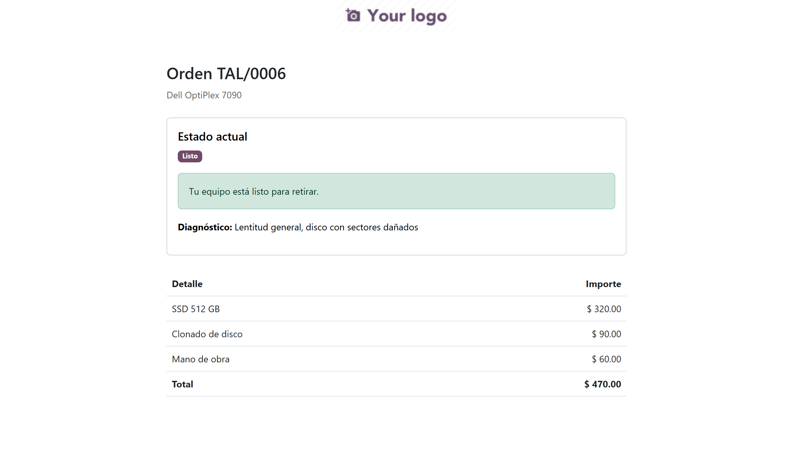

El cliente dejó su equipo y quiere saber cómo va sin llamar por teléfono. Le damos una URL.

Esta lección es QWeb del lado del servidor, igual que los reportes. **Nada de JavaScript** — eso es el otro curso.

## El token de acceso

Primero, cómo probamos que el que pide tiene derecho. Un id no alcanza, como vimos en la lección anterior.

```python models/service_order.py
import uuid

access_token = fields.Char(
    string="Token de acceso",
    default=lambda self: str(uuid.uuid4()),
    copy=False,
    readonly=True,
    groups="service_workshop.group_service_technician",
)

def _portal_url(self):
    self.ensure_one()
    base = self.env["ir.config_parameter"].sudo().get_param("web.base.url")
    return f"{base}/taller/orden/{self.id}?token={self.access_token}"
```

Tres decisiones ahí:

**Un UUID4**, que no se puede adivinar ni recorrer secuencialmente.

**`copy=False`**, de la lección de campos: duplicar una orden no debe duplicar el token.

**`groups=`**, para que el token no se filtre: solo lo ven los del taller.

Y `web.base.url` es el parámetro donde Odoo guarda su dirección pública. Usarlo en vez de escribir el dominio a mano hace que el enlace funcione igual en desarrollo y en producción.

## El controlador

```python controllers/portal.py
from odoo import http
from odoo.http import request
from odoo.tools import consteq


class ServicePortal(http.Controller):

    @http.route("/taller/orden/<int:order_id>", type="http", auth="public", website=True)
    def ver_orden(self, order_id, token=None, **kwargs):
        order = request.env["service.order"].sudo().browse(order_id).exists()

        if not order or not token or not consteq(order.access_token, token):
            return request.not_found()

        return request.render("service_workshop.portal_service_order", {
            "order": order,
            "page_name": "service_order",
        })
```

La guarda de tres condiciones es la de la lección anterior: que exista, que haya token, y que el token coincida comparado con `consteq`.

**Devolver `not_found()` y no un error** es deliberado: no le confirmamos a nadie que esa orden existe. Un «token inválido» ya es información.

El `website=True` hace que la página use el layout del sitio si el módulo `website` está instalado.

## La plantilla

```xml views/portal_templates.xml
<?xml version="1.0" encoding="utf-8"?>
<odoo>
    <template id="portal_service_order" name="Estado de la orden">
        <t t-call="portal.portal_layout">
            <div class="container py-4">
                <h3>
                    Orden <span t-field="order.code"/>
                </h3>
                <p class="text-muted">
                    <span t-field="order.equipment_id"/>
                </p>

                <div class="card mt-4">
                    <div class="card-body">
                        <h5 class="card-title">Estado actual</h5>
                        <p class="card-text">
                            <span t-field="order.state" class="badge text-bg-primary"/>
                        </p>

                        <div t-if="order.state == 'ready'" class="alert alert-success">
                            Tu equipo está listo para retirar.
                        </div>

                        <p t-if="order.diagnosis">
                            <strong>Diagnóstico:</strong>
                            <span t-field="order.diagnosis"/>
                        </p>
                    </div>
                </div>

                <table class="table mt-4" t-if="order.line_ids">
                    <thead>
                        <tr>
                            <th>Detalle</th>
                            <th class="text-end">Importe</th>
                        </tr>
                    </thead>
                    <tbody>
                        <tr t-foreach="order.line_ids" t-as="line">
                            <td><span t-field="line.name"/></td>
                            <td class="text-end"><span t-field="line.subtotal"/></td>
                        </tr>
                    </tbody>
                    <tfoot>
                        <tr>
                            <th>Total</th>
                            <th class="text-end"><span t-field="order.amount_total"/></th>
                        </tr>
                    </tfoot>
                </table>
            </div>
        </t>
    </template>
</odoo>
```


*Sin login y sin JavaScript: QWeb del lado del servidor y un token en la URL.*

Las directivas son **las mismas de los reportes**: `t-field`, `t-if`, `t-foreach`. QWeb es uno solo; cambia el layout que lo envuelve.

`portal.portal_layout` da la cabecera, el pie y los estilos del portal de Odoo. Para una página totalmente propia, `web.frontend_layout`.

Y Bootstrap está disponible, igual que en los reportes.

## Qué mostrar y qué no

El `order` del contexto llegó por `sudo()`, así que **la plantilla puede leer cualquier campo**. La seguridad de campos no te protege acá.

Eso lo decidís vos, y conviene pensarlo:

| Mostrar | No mostrar |
|---|---|
| estado, equipo, diagnóstico | el costo interno |
| las líneas y el total | quién es el técnico |
| las fechas | las notas internas del chatter |

Un portal que muestra de más es una fuga de datos silenciosa. Escribí la plantilla campo por campo, nunca con un bucle sobre todos.

## Mandarle el enlace al cliente

Se engancha con la plantilla de correo de la sección anterior:

```xml data/mail_template_data.xml
<p>
    Podés seguir el estado acá:
    <a t-att-href="object._portal_url()">Ver mi orden</a>
</p>
```

`t-att-href` construye el atributo desde una expresión. Es la directiva que faltaba de la tabla de QWeb.

## El portal con login

Lo anterior no necesita cuenta. Si el cliente tiene usuario de portal, se puede hacer algo mejor: una lista de todas sus órdenes.

```python controllers/portal.py
from odoo.addons.portal.controllers.portal import CustomerPortal


class ServiceCustomerPortal(CustomerPortal):

    def _prepare_home_portal_values(self, counters):
        valores = super()._prepare_home_portal_values(counters)
        if "service_count" in counters:
            valores["service_count"] = request.env["service.order"].search_count(
                self._get_service_domain()
            )
        return valores

    def _get_service_domain(self):
        partner = request.env.user.partner_id
        return [("partner_id", "child_of", partner.commercial_partner_id.id)]

    @http.route("/my/taller", type="http", auth="user", website=True)
    def mis_ordenes(self, **kwargs):
        ordenes = request.env["service.order"].sudo().search(self._get_service_domain())
        return request.render("service_workshop.portal_my_orders", {"ordenes": ordenes})
```

El dominio es la pieza de seguridad: **`child_of` sobre el `commercial_partner_id`** hace que un contacto de una empresa vea las órdenes de toda la empresa, incluidas las de sus otras sucursales. Es el patrón que usa Odoo en ventas y facturación.

### Por qué hace falta `sudo()` acá

Los usuarios de portal están en `base.group_portal`, que —como vimos en la lección de grupos— **no hereda de `base.group_user`**. No tienen permiso de leer `service.order` y dárselo sería peor: podrían leer todas.

Por eso el patrón es `sudo()` **con un dominio que ya los limita**. La seguridad no viene de los permisos, viene del dominio, y por eso ese dominio tiene que estar en un método aparte, bien visible y revisado.

## Probarlo

El usuario público no tiene acceso a nada, así que la mejor prueba es **en una ventana de incógnito**, sin sesión:

1. Copiá la URL con el token y abrila. Tiene que mostrar la orden.
2. Cambiá un carácter del token. Tiene que dar 404.
3. Sacá el token. 404.
4. Probá con el id de otra orden y el mismo token. 404.

Si las cuatro dan lo esperado, el portal está bien.

> **Quedate con esto**
> El token es lo que reemplaza al login: UUID, `copy=False`, restringido por `groups`, y comparado con `consteq`. Devolvé `not_found()` ante cualquier fallo, porque un mensaje distinto ya revela que la orden existe. Y en el portal con login, la seguridad está en el dominio con `child_of`, no en los permisos — por eso ese dominio merece su propio método.
