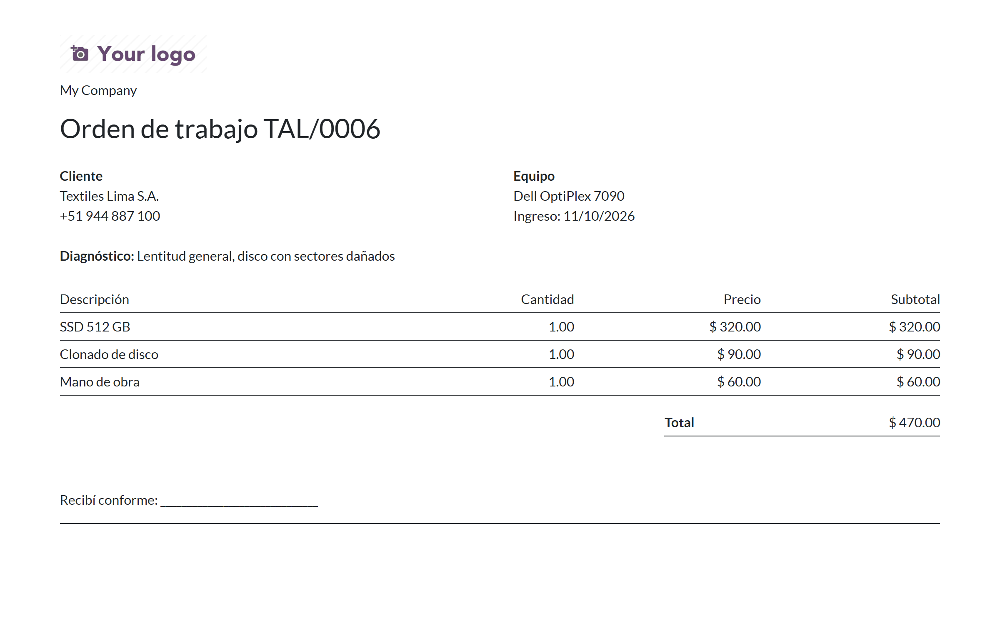

Acordate de la primera lección del curso: **Odoo no genera PDFs, genera HTML y se lo pasa a wkhtmltopdf**. Un reporte es, literalmente, una página web que se imprime.

Eso es una buena noticia: si sabés HTML, sabés hacer reportes.

## La acción de reporte

```xml reports/service_order_report.xml
<record id="action_report_service_order" model="ir.actions.report">
    <field name="name">Orden de trabajo</field>
    <field name="model">service.order</field>
    <field name="report_type">qweb-pdf</field>
    <field name="report_name">service_workshop.report_service_order</field>
    <field name="report_file">service_workshop.report_service_order</field>
    <field name="binding_model_id" ref="model_service_order"/>
    <field name="binding_type">report</field>
    <field name="print_report_name">'Orden %s' % object.code</field>
</record>
```

- **`report_name`** — el identificador de la plantilla, con prefijo del módulo. Tiene que coincidir exactamente.
- **`binding_model_id`** y **`binding_type="report"`** — hacen que aparezca en el menú «Imprimir» del formulario y de la lista.
- **`print_report_name`** — **una expresión Python** que nombra el archivo. `object` es el registro. Sin esto, el PDF se descarga como «Orden de trabajo.pdf» para todas las órdenes, y el usuario termina con diez archivos iguales en Descargas.

## La plantilla

```xml reports/service_order_report.xml
<template id="report_service_order">
    <t t-call="web.html_container">
        <t t-foreach="docs" t-as="doc">
            <t t-call="web.external_layout">
                <div class="page">
                    <h2>Orden de trabajo <span t-field="doc.code"/></h2>

                    <div class="row mt-4">
                        <div class="col-6">
                            <strong>Cliente</strong>
                            <div t-field="doc.partner_id"/>
                            <div t-field="doc.partner_phone"/>
                        </div>
                        <div class="col-6">
                            <strong>Equipo</strong>
                            <div t-field="doc.equipment_id"/>
                            <div>Ingreso: <span t-field="doc.date_in"/></div>
                        </div>
                    </div>

                    <p t-if="doc.diagnosis" class="mt-4">
                        <strong>Diagnóstico:</strong>
                        <span t-field="doc.diagnosis"/>
                    </p>

                    <table class="table table-sm mt-4" t-if="doc.line_ids">
                        <thead>
                            <tr>
                                <th>Descripción</th>
                                <th class="text-end">Cantidad</th>
                                <th class="text-end">Precio</th>
                                <th class="text-end">Subtotal</th>
                            </tr>
                        </thead>
                        <tbody>
                            <tr t-foreach="doc.line_ids" t-as="line">
                                <td><span t-field="line.name"/></td>
                                <td class="text-end"><span t-field="line.quantity"/></td>
                                <td class="text-end"><span t-field="line.price_unit"/></td>
                                <td class="text-end"><span t-field="line.subtotal"/></td>
                            </tr>
                        </tbody>
                    </table>

                    <div class="row justify-content-end">
                        <div class="col-4">
                            <table class="table table-sm">
                                <tr>
                                    <td><strong>Total</strong></td>
                                    <td class="text-end">
                                        <span t-field="doc.amount_total"/>
                                    </td>
                                </tr>
                            </table>
                        </div>
                    </div>

                    <p class="mt-5">
                        Recibí conforme: ______________________________
                    </p>
                </div>
            </t>
        </t>
    </t>
</template>
```

Y esto es lo que produce:


*El encabezado con los datos de la empresa no está en nuestra plantilla: lo pone `web.external_layout`.*

## Las directivas de QWeb

QWeb es el motor de plantillas de Odoo. Son atributos `t-` sobre etiquetas HTML normales.

| Directiva | Qué hace |
|---|---|
| `t-field` | imprime un campo **con su formato** |
| `t-esc` | imprime una expresión, escapando HTML |
| `t-out` | imprime sin escapar (para campos Html) |
| `t-if` / `t-elif` / `t-else` | condicional |
| `t-foreach` / `t-as` | bucle |
| `t-call` | incluye otra plantilla |
| `t-att-X` | atributo calculado |
| `t-set` | define una variable |

### `t-field` vs `t-esc`

Es la distinción que más importa.

```xml
<span t-field="doc.amount_total"/>     <!-- S/ 570.00 -->
<span t-esc="doc.amount_total"/>       <!-- 570.0 -->
```

**`t-field` conoce el campo**: le aplica el formato del tipo. Una fecha sale en el formato del idioma, un `Monetary` con su símbolo y sus decimales, un Many2one con su `display_name`.

**`t-esc` imprime el valor crudo.**

Para campos de un registro, **usá siempre `t-field`**. `t-esc` es para expresiones calculadas.

### Las variables disponibles

- **`docs`** — los registros a imprimir. Siempre es un recordset, aunque sea uno.
- **`doc`** — cada uno dentro del `t-foreach`.
- **`company`** — la compañía.
- **`user`** — el usuario.

## Los dos `t-call` que hacen la mitad del trabajo

```xml
<t t-call="web.html_container">
    <t t-call="web.external_layout">
```

**`web.html_container`** arma el documento HTML: el `<html>`, el `<head>`, los estilos de Odoo. Siempre va afuera.

**`web.external_layout`** agrega **el encabezado y el pie de la empresa**: logo, razón social, dirección, numeración de páginas. Es lo que hace que tu reporte se vea como los de Odoo y no como una tabla suelta.

Para un documento interno que no necesita membrete, existe `web.internal_layout`.

Y acá se cierra el círculo con la primera lección: **si wkhtmltopdf está mal instalado, el encabezado y el pie no aparecen** y el resto del PDF sale bien. Ese síntoma tan específico es el que te dice que el binario está mal.

## Bootstrap está disponible

El layout de Odoo trae Bootstrap, así que podés usar sus clases: `row`, `col-6`, `table`, `text-end`, `mt-4`.

Aprovechalo en lugar de escribir CSS: menos código y resultado consistente con el resto.

## El formato de página

```xml reports/service_order_report.xml
<record id="paperformat_service_order" model="report.paperformat">
    <field name="name">Orden de trabajo A4</field>
    <field name="format">A4</field>
    <field name="orientation">Portrait</field>
    <field name="margin_top">35</field>
    <field name="margin_bottom">25</field>
    <field name="header_spacing">30</field>
    <field name="dpi">90</field>
</record>
```

Y se lo asignás a la acción con `<field name="paperformat_id" ref="paperformat_service_order"/>`.

El `margin_top` junto con `header_spacing` es lo que hay que ajustar cuando **el encabezado se superpone con el contenido**. Es el problema más común de los reportes y se arregla con esos dos números.

## Saltos de página

```xml
<div style="page-break-after: always;"/>
```

CSS normal. Para que cada orden salga en su propia hoja, va dentro del `t-foreach`, al final.

## Declararlo

```python __manifest__.py
"data": [
    ...
    "reports/service_order_report.xml",
],
```

Los reportes son datos como todo lo demás.

## Cómo probarlo sin generar el PDF

Generar un PDF es lento y no te deja inspeccionar nada. Hay un atajo: con el modo desarrollador activo, el menú del bicho tiene **«Reporte técnico» → «Ver como HTML»**.

El reporte se abre en el navegador como página web. Podés usar las herramientas de desarrollo, ver qué se renderizó y recargar al instante.

**Diseñá en HTML y generá el PDF solo al final.** La diferencia de velocidad es enorme.

## Una advertencia

QWeb corre **con los permisos del usuario**. Si un técnico imprime una orden y la plantilla referencia un campo restringido como `cost_total`, el reporte falla con un error de acceso.

Si necesitás mostrar algo que no todos pueden ver, envolvelo en una condición por grupo:

```xml
<p t-if="user.has_group('service_workshop.group_service_manager')">
    Costo interno: <span t-field="doc.cost_total"/>
</p>
```

> **Quedate con esto**
> `t-field` formatea según el tipo del campo y `t-esc` imprime crudo: para campos de un registro, siempre `t-field`. Los dos `t-call` de arriba te dan el documento y el membrete de la empresa. Y diseñá mirando el HTML con «Ver como HTML» en vez de regenerar el PDF cada vez.
