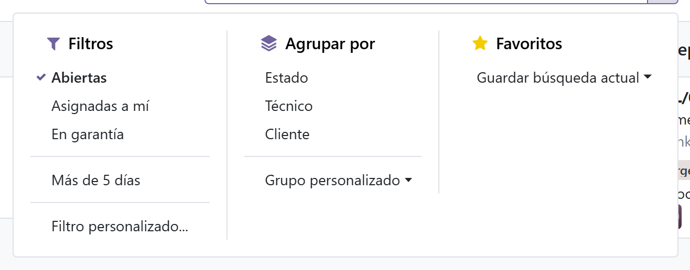

De todas las vistas, la de búsqueda es la que más se usa y la que menos se diseña. El formulario se piensa con cuidado; la búsqueda se deja en el default y ahí queda.


*Filtros a la izquierda, agrupaciones a la derecha. Todo esto sale del XML de esta lección.*

Es un error, porque es la pantalla donde el usuario pasa el día: buscando la orden de un cliente, viendo qué hay sin entregar, contando cuánto lleva cada técnico.

## La vista completa

```xml views/service_order_views.xml
<record id="view_service_order_search" model="ir.ui.view">
    <field name="name">service.order.search</field>
    <field name="model">service.order</field>
    <field name="arch" type="xml">
        <search string="Órdenes de servicio">
            <field name="code" string="Orden"/>
            <field name="partner_id" operator="child_of"/>
            <field name="equipment_id"/>
            <field name="user_id"/>
            <field name="tag_ids"/>

            <filter name="abiertas" string="Abiertas"
                    domain="[('state', 'not in', ['done', 'cancel'])]"/>
            <filter name="mias" string="Asignadas a mí"
                    domain="[('user_id', '=', uid)]"/>
            <filter name="garantia" string="En garantía"
                    domain="[('is_warranty', '=', True)]"/>

            <separator/>
            <filter name="demoradas" string="Más de 5 días"
                    domain="[('days_in_shop', '>', 5)]"/>

            <separator/>
            <filter name="este_mes" string="Este mes"
                    domain="[('date_in', '&gt;=', (context_today() - relativedelta(day=1)).strftime('%Y-%m-%d'))]"/>

            <group>
                <filter name="group_state" string="Estado" domain="[]" context="{'group_by': 'state'}"/>
                <filter name="group_user" string="Técnico" domain="[]" context="{'group_by': 'user_id'}"/>
                <filter name="group_partner" string="Cliente" domain="[]" context="{'group_by': 'partner_id'}"/>
                <filter name="group_date" string="Mes de ingreso" domain="[]" context="{'group_by': 'date_in:month'}"/>
            </group>
        </search>
    </field>
</record>
```

## Los `<field>`: lo que se busca al escribir

Los campos declarados arriba son los que Odoo ofrece cuando el usuario escribe en la barra. Escribís «Andina» y te propone buscar por orden, por cliente, por equipo.

**El orden importa**: el primero es el que se usa al apretar Enter sin elegir nada.

```xml
<field name="partner_id" operator="child_of"/>
```

El atributo `operator` cambia cómo se compara. `child_of` sobre un partner incluye sus contactos hijos — buscar la empresa trae también las órdenes cargadas a nombre de sus sucursales. Es el tipo de detalle que hace que una búsqueda se sienta inteligente.

Por defecto el operador es `ilike`, o sea «contiene, sin distinguir mayúsculas».

### Buscar por un campo de otro modelo

```xml
<field name="partner_id" filter_domain="['|', ('partner_id', 'ilike', self), ('equipment_id.serial', 'ilike', self)]"/>
```

`filter_domain` te deja escribir el dominio exacto, y **`self` es lo que tecleó el usuario**. Con eso, un solo campo de búsqueda cubre el nombre del cliente y el número de serie del equipo a la vez.

## Los `<filter>`: los que se clickean

```xml
<filter name="abiertas" string="Abiertas" domain="[('state', 'not in', ['done', 'cancel'])]"/>
```

Son filtros con un dominio fijo.

Lo que conviene saber de cómo se combinan:

- **Filtros contiguos se combinan con OR.** «En garantía» y «Asignadas a mí» juntos traen las que cumplen *cualquiera* de las dos.
- **`<separator/>` corta ese grupo**, y a partir de ahí se combina con AND.

Por eso en el ejemplo hay separadores antes de «Más de 5 días» y antes de «Este mes»: queremos que esos se sumen con AND a lo que ya esté seleccionado, no que amplíen el resultado.

Es un comportamiento que sorprende la primera vez y que se vuelve obvio cuando lo ves: filtros relacionados juntos, filtros independientes separados.

### Variables disponibles en los dominios

```xml
domain="[('user_id', '=', uid)]"
```

- **`uid`** — el id del usuario actual.
- **`context_today()`** — la fecha de hoy en la zona del usuario.
- **`relativedelta`** — para aritmética de fechas.
- **`datetime`**, **`time`** — los módulos de Python.

Un detalle de XML: `>` y `<` hay que escribirlos como `&gt;` y `&lt;`, porque están dentro de un atributo.

## `<group>`: agrupar

```xml
<group>
    <filter name="group_user" string="Técnico" domain="[]" context="{'group_by': 'user_id'}"/>
</group>
```

Agrupar no filtra: reorganiza. La lista se parte en secciones plegables con sus subtotales, que es donde las columnas con `sum` muestran su valor.

El `domain="[]"` vacío deja claro que el filtro **solo agrupa y no filtra nada**. Es lo que hace el core y conviene copiarlo.

> **Si venís de versiones anteriores**
> Este `<group>` llevaba `expand="0"` y un `string="Agrupar por"`. **En Odoo 19 esos atributos ya no son válidos** dentro de una vista de búsqueda: el validador RelaxNG rechaza la vista entera con un `Invalid attribute expand for element group` y el módulo no instala. Ahora el elemento va pelado.

Para fechas podés elegir la granularidad con dos puntos:

```xml
context="{'group_by': 'date_in:month'}"
```

Acepta `day`, `week`, `month`, `quarter` y `year`.

Y una restricción que ya conocés: **solo se puede agrupar por campos almacenados**. Es PostgreSQL quien hace el `GROUP BY`. Un calculado sin `store=True` no aparece en la lista de agrupaciones.

## Filtros activos por defecto

Una búsqueda que arranca vacía obliga a filtrar siempre lo mismo. Mejor que el módulo abra ya útil:

```xml views/service_order_views.xml · En la acción
<record id="action_service_order" model="ir.actions.act_window">
    ...
    <field name="context">{"search_default_abiertas": 1}</field>
</record>
```

**`search_default_` más el `name` del filtro** lo deja activo al abrir. Para agrupar: `{"search_default_group_user": 1}`.

Esta es la razón por la que el atributo `name` de cada filtro importa: es su identificador. Si no lo ponés, no podés activarlo por defecto ni referenciarlo desde otro módulo.

Y es **un valor por defecto, no una imposición**: el usuario lo ve como un filtro más y lo puede sacar. Para un filtro que no se pueda quitar, va el `domain` de la acción.

## El panel lateral

```xml
<search string="Órdenes de servicio">
    <field name="code"/>
    ...
    <searchpanel>
        <field name="state" icon="fa-tasks" enable_counters="1"/>
        <field name="user_id" icon="fa-users" enable_counters="1" select="multi"/>
    </searchpanel>
</search>
```

Dibuja una columna a la izquierda con los valores del campo y, con `enable_counters="1"`, cuántos registros hay en cada uno.

Es la forma más cómoda de navegar que ofrece Odoo: un clic y estás viendo las órdenes de ese técnico, con el número a la vista sin tener que agrupar.

`select="multi"` permite elegir varios valores a la vez; sin eso, es uno solo.

No abuses: dos o tres campos como mucho. El panel come ancho de pantalla.

## Enganchar la vista

Igual que las otras: con una sola vista de búsqueda para el modelo, Odoo la toma sola. No hay que declarar nada en la acción.

## Un criterio para diseñarla

Pensá en las tres o cuatro preguntas que el usuario se hace todos los días, y que cada una sea un clic:

- ¿Qué tengo pendiente? → filtro «Abiertas», activo por defecto.
- ¿Qué me toca a mí? → «Asignadas a mí».
- ¿Qué se está demorando? → «Más de 5 días».
- ¿Cómo viene cada técnico? → agrupar por técnico.

Si para responder una de esas hay que escribir un filtro a mano, falta un `<filter>`.

> **Quedate con esto**
> Los filtros contiguos se combinan con OR y `<separator/>` cambia a AND — es lo que más confunde al principio. El `name` de cada filtro es lo que te deja activarlo por defecto con `search_default_`, y agrupar solo funciona sobre campos almacenados.
