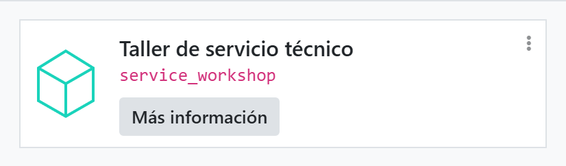

Vamos a crear el módulo que nos va a acompañar todo el curso. En esta lección no hace nada todavía: solo existe, se instala y aparece. Eso es exactamente lo que queremos — que el primer paso sea chico y verificable.

El módulo es **`service_workshop`**: un taller de servicio técnico. Entran equipos de clientes, se diagnostican, se reparan y se entregan. Es un caso que Odoo Community no cubre, así que escribirlo se justifica solo, y ejercita el patrón que vas a repetir en cualquier módulo de negocio.

## Una decisión que conviene tomar ahora

Los **identificadores técnicos van en inglés** —`service.order`, `partner_id`, `stage_id`— y los **textos que ve el usuario, en español**.

No es purismo. Es que vas a heredar `res.partner`, extender `mail.thread` y leer módulos estándar todos los días, y todos están en inglés. Un modelo `taller.orden` con un campo `cliente_id` conviviendo con `partner_id` heredado produce un código donde nunca sabés en qué idioma está la cosa que buscás. Para los textos, en cambio, Odoo ya tiene traducciones: esa es la capa que corresponde.

Si preferís lo contrario, es tu módulo. Pero elegilo ahora, no en la lección 20.

## A mano, que son cuatro archivos

Ya sabés para qué sirve cada uno, así que no es boilerplate: es el módulo mínimo.

```bash Terminal · Las carpetas
cd addons
mkdir -p service_workshop/models
cd service_workshop
```

```python service_workshop/__manifest__.py
{
    "name": "Taller de servicio técnico",
    "summary": "Órdenes de reparación, diagnóstico y entrega",
    "version": "19.0.1.0.0",
    "category": "Services",
    "author": "Tu nombre",
    "license": "LGPL-3",
    "depends": ["base"],
    "data": [],
    "application": True,
}
```

```python service_workshop/__init__.py
from . import models
```

```python service_workshop/models/__init__.py
```

Sí: `models/__init__.py` queda vacío. Todavía no hay ningún modelo que importar. En la próxima sección empieza a llenarse.

Fijate que `data` es una lista vacía. Es válido, y es honesto: este módulo aún no carga ningún archivo.

## La alternativa: `scaffold`

Odoo trae un comando que genera el esqueleto:

```bash Terminal · Generar el esqueleto
odoo-bin scaffold service_workshop ./addons
```

Te deja las carpetas `models`, `views`, `controllers`, `security` y `demo` con archivos de ejemplo comentados.

**No lo uso al empezar**, y te recomiendo lo mismo por una lección: el scaffold te deja seis archivos que no escribiste, con código comentado que no entendés todavía, y la primera reacción es dejarlos ahí por las dudas. Crear los cuatro archivos a mano la primera vez es lo que hace que la lección anterior se te quede.

Una vez que te sepa de memoria, el scaffold ahorra tiempo. Ese es su momento.

## Instalarlo

### Desde la interfaz

Acá viene la trampa que vengo anunciando desde la primera lección. Copiás el módulo, vas a **Aplicaciones** y no está.

No es un error. Odoo armó la lista de módulos disponibles cuando creaste la base, y nadie le avisó de este.

Con el modo desarrollador activo, entrá a **Aplicaciones** y mirá la barra de menú de arriba:


*Sin el modo desarrollador, esos tres menús no existen.*

1. Hacé clic en **Actualizar lista de aplicaciones** y confirmá.
2. En el buscador, **borrá el filtro «Aplicaciones»**. Es el segundo tropiezo: ese filtro muestra solo los módulos con `application: True`, y aunque el nuestro lo tiene, apenas empieces a escribir módulos satélite van a quedar escondidos detrás de ese filtro y vas a jurar que no se instalaron.
3. Buscá `service_workshop` y dale **Activar**.

Si seguiste alguna guía vieja buscando esto en un menú **⋮**, ahí ya no está: en Odoo 19 son ítems del menú superior.

### Desde la línea de comandos

Más rápido cuando ya sabés lo que querés, y es la forma de hacerlo en un script o en CI.

```bash Terminal · Instalación nativa
./odoo-bin -c odoo.conf -d taller -i service_workshop --stop-after-init
```

```bash Terminal · Con Docker
docker compose stop odoo
docker compose run --rm odoo odoo -d taller -i service_workshop --stop-after-init
docker compose start odoo
```

El `--stop-after-init` hace que Odoo haga el trabajo y se cierre, en vez de quedarse levantado. Y en Docker frenamos el servicio antes porque dos procesos de Odoo tocando la misma base al mismo tiempo es pedir problemas.

## `-i` y `-u`: la diferencia que importa

```bash Terminal · Los dos que vas a usar siempre
-i service_workshop    # instalar
-u service_workshop    # actualizar uno ya instalado
```

**`-i` solo funciona si el módulo no está instalado.** Si ya lo está, no hace nada — ni avisa.

**`-u` es el que vas a usar el 95% del tiempo**, cada vez que toques el manifest, agregues un modelo o cambies un archivo de datos. Vuelve a cargar las definiciones de los modelos —creando o alterando columnas en PostgreSQL si hace falta— y vuelve a procesar los archivos de la lista `data`.

Mientras desarrollás con `--dev=xml` no vas a necesitar `-u` para los cambios de vistas: recargás el navegador y listo. Pero **sí lo vas a necesitar** cuando agregues un campo, cuando sumes un archivo nuevo a `data` o cuando cambies el manifest.

Si alguna vez cambiaste algo y «no se aplica», la pregunta es: ¿corriste `-u`?

## Qué hace Odoo cuando instala

Vale la pena conocer el orden, porque explica varios errores que vas a ver:

1. Corre el hook `pre_init`, si lo definiste.
2. **Lee las clases de Python y actualiza la estructura de la base** — crea tablas, agrega columnas.
3. **Carga los archivos de `data`**, en el orden de la lista.
4. Carga los de `demo`, si la base se creó con datos de demostración.
5. Corre el hook `post_init`.
6. **Valida las vistas** que definiste.

Dos cosas que se entienden mejor con esto a la vista.

**Los modelos van antes que los datos.** Por eso un archivo XML puede referenciar un modelo con confianza: para cuando se carga, la tabla ya existe.

**Las vistas se validan al final.** Si escribiste mal el nombre de un campo en una vista, el error no aparece al guardar el archivo, sino al instalar o actualizar — y te dice que el campo no existe en el modelo. Es el error más común de todos los principiantes en Odoo y ahora sabés en qué paso se produce.

También pasa algo que no está en la lista: si tu módulo depende de otros que no están instalados, **Odoo los instala primero, recursivamente**. Instalar un módulo puede terminar instalando media docena.

## Confirmá que quedó

Con el modo desarrollador activo, la lista de Aplicaciones muestra el nombre técnico debajo del título:


*El nombre técnico en rojo solo aparece con el modo desarrollador. Es la forma más rápida de saber cómo se llama de verdad un módulo.*

Si ves eso, el módulo está instalado. Todavía no hace nada — en la próxima sección empieza a tener modelos.

> **Quedate con esto**
> `-i` instala, `-u` actualiza, y `-u` es el que vas a escribir mil veces. Que un módulo nuevo no aparezca en la lista casi nunca es un error: es la lista de aplicaciones sin actualizar, o el filtro «Aplicaciones» escondiéndolo.
