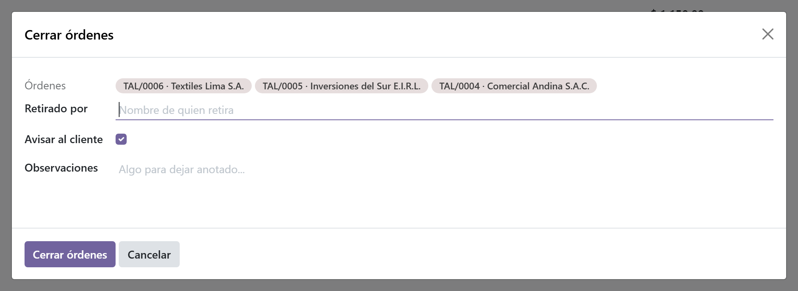

Hay acciones que necesitan información que no es del registro. Para cerrar una orden querés anotar quién la retiró; ese dato se usa una vez y no tiene por qué vivir como campo de la orden.

Para eso están los wizards: **un modelo que existe el tiempo del diálogo y después se borra solo**.

## `TransientModel`

```python wizards/service_close_wizard.py
from odoo import fields, models


class ServiceCloseWizard(models.TransientModel):
    _name = "service.close.wizard"
    _description = "Cerrar órdenes de servicio"

    order_ids = fields.Many2many("service.order", string="Órdenes")
    delivered_to = fields.Char(string="Retirado por", required=True)
    notes = fields.Text(string="Observaciones")
    notify_customer = fields.Boolean(string="Avisar al cliente", default=True)
```

`TransientModel` se declara igual que un `Model` y se comporta casi igual: tiene su tabla, sus campos, sus métodos.

La diferencia es que **Odoo limpia sus registros periódicamente**, con un trabajo programado. No tenés que borrar nada.

Dos consecuencias prácticas:

**No guardes nada ahí que importe.** Es un buffer, no un registro.

**Igual necesita permisos de acceso.** Es el olvido más frecuente:

```csv security/ir.model.access.csv
access_service_close_wizard,cerrar órdenes,model_service_close_wizard,service_workshop.group_service_technician,1,1,1,0
```

Sin esa línea, el asistente tira un error de acceso sobre un modelo que ni sabías que tenía permisos.

## La vista

```xml wizards/service_close_wizard_views.xml
<record id="view_service_close_wizard_form" model="ir.ui.view">
    <field name="name">service.close.wizard.form</field>
    <field name="model">service.close.wizard</field>
    <field name="arch" type="xml">
        <form string="Cerrar órdenes">
            <group>
                <field name="order_ids" widget="many2many_tags" readonly="1"/>
                <field name="delivered_to" placeholder="Nombre de quien retira"/>
                <field name="notify_customer"/>
                <field name="notes" placeholder="Algo para dejar anotado..."/>
            </group>
            <footer>
                <button name="action_close" type="object" string="Cerrar órdenes" class="btn-primary"/>
                <button string="Cancelar" class="btn-secondary" special="cancel"/>
            </footer>
        </form>
    </field>
</record>
```

Dos particularidades frente a un formulario normal:

**`<footer>`** pone los botones abajo del diálogo, que es donde el usuario los busca.

**`special="cancel"`** es un botón que simplemente cierra sin hacer nada. No necesita método.

## Abrirlo

```xml wizards/service_close_wizard_views.xml
<record id="action_service_close_wizard" model="ir.actions.act_window">
    <field name="name">Cerrar órdenes</field>
    <field name="res_model">service.close.wizard</field>
    <field name="view_mode">form</field>
    <field name="target">new</field>
    <field name="binding_model_id" ref="model_service_order"/>
    <field name="binding_view_types">list,form</field>
</record>
```

**`target="new"`** es lo que lo hace un diálogo modal. Sin eso se abriría como una pantalla normal, que no es lo que querés.

**`binding_model_id`** lo agrega al menú de acciones de la lista de órdenes: el usuario selecciona varias, abre el engranaje y ahí está. Es la forma estándar de ofrecer una acción en lote.

## Saber sobre qué actuar

Cuando el wizard se abre desde una selección, el contexto trae los ids. Acá es donde entra `default_get`:

```python wizards/service_close_wizard.py
from odoo import api, fields, models


class ServiceCloseWizard(models.TransientModel):
    _name = "service.close.wizard"
    _description = "Cerrar órdenes de servicio"

    order_ids = fields.Many2many("service.order", string="Órdenes")
    delivered_to = fields.Char(string="Retirado por", required=True)
    notes = fields.Text(string="Observaciones")
    notify_customer = fields.Boolean(string="Avisar al cliente", default=True)

    @api.model
    def default_get(self, fields_list):
        valores = super().default_get(fields_list)
        ids = self.env.context.get("active_ids", [])
        if ids:
            valores["order_ids"] = [(6, 0, ids)]
        return valores
```

`default_get` corre **antes de que se dibuje el formulario** y devuelve los valores iniciales. Es el gancho correcto para precargar un wizard.


*Las tres órdenes llegaron solas desde `active_ids`. Abajo, el `<footer>` con el botón principal y el `special="cancel"`.*

Las claves del contexto que ya vimos en la lección de dominios:

- **`active_ids`** — los registros seleccionados en la lista.
- **`active_id`** — el único registro, si se abrió desde un formulario.
- **`active_model`** — de qué modelo son.

## El método que hace el trabajo

```python wizards/service_close_wizard.py
def action_close(self):
    self.ensure_one()

    sin_diagnostico = self.order_ids.filtered(lambda o: not o.diagnosis)
    if sin_diagnostico:
        raise UserError(
            "Estas órdenes no tienen diagnóstico: %s"
            % ", ".join(sin_diagnostico.mapped("code"))
        )

    self.order_ids.write({
        "state": "done",
        "date_done": fields.Date.context_today(self),
    })

    for order in self.order_ids:
        order.message_post(body=f"Retirado por {self.delivered_to}. {self.notes or ''}")

    return {"type": "ir.actions.act_window_close"}
```

Fijate cómo se usa todo lo de las secciones anteriores: `ensure_one` porque el wizard es uno solo, `filtered` y `mapped` sobre el recordset, un `write` en lote.

**El `return`** decide qué pasa después:

| Devolvés | Qué hace |
|---|---|
| `{"type": "ir.actions.act_window_close"}` | cierra el diálogo |
| `None` o nada | igual que cerrar |
| otra acción | abre esa pantalla |
| el mismo wizard | lo deja abierto, útil para un segundo paso |

Ese último es el truco para wizards de varios pasos: devolvés una acción que apunta al mismo registro del wizard, con un campo `step` que cambia qué se muestra.

## Devolver una acción con resultado

Lo más útil que puede hacer un wizard es llevarte a lo que acaba de generar:

```python
def action_close(self):
    self.ensure_one()
    self.order_ids.write({"state": "done"})
    return {
        "type": "ir.actions.act_window",
        "name": "Órdenes cerradas hoy",
        "res_model": "service.order",
        "view_mode": "list,form",
        "domain": [("id", "in", self.order_ids.ids)],
    }
```

El usuario cierra diez órdenes y queda mirando exactamente esas diez. Es mucho mejor que devolverlo a la lista completa sin saber qué pasó.

## Cuándo un wizard y cuándo no

**Sí**, cuando necesitás datos que no son del registro, cuando la acción es en lote sobre varios, o cuando conviene confirmar antes de algo irreversible.

**No**, cuando el dato pertenece al registro —entonces es un campo— ni para mostrar información, que para eso está una vista normal.

Y tampoco para confirmar cualquier cosa: un wizard por cada acción vuelve el módulo cansador. Reservalo para lo que de verdad lo amerita.

> **Quedate con esto**
> `TransientModel` se limpia solo, pero **necesita su línea en `ir.model.access.csv`** igual que cualquier modelo. `default_get` con `active_ids` es cómo sabe sobre qué actuar, `target="new"` lo hace modal y `binding_model_id` lo mete en el menú de acciones de la lista. Y devolver una acción al final deja al usuario mirando el resultado.
