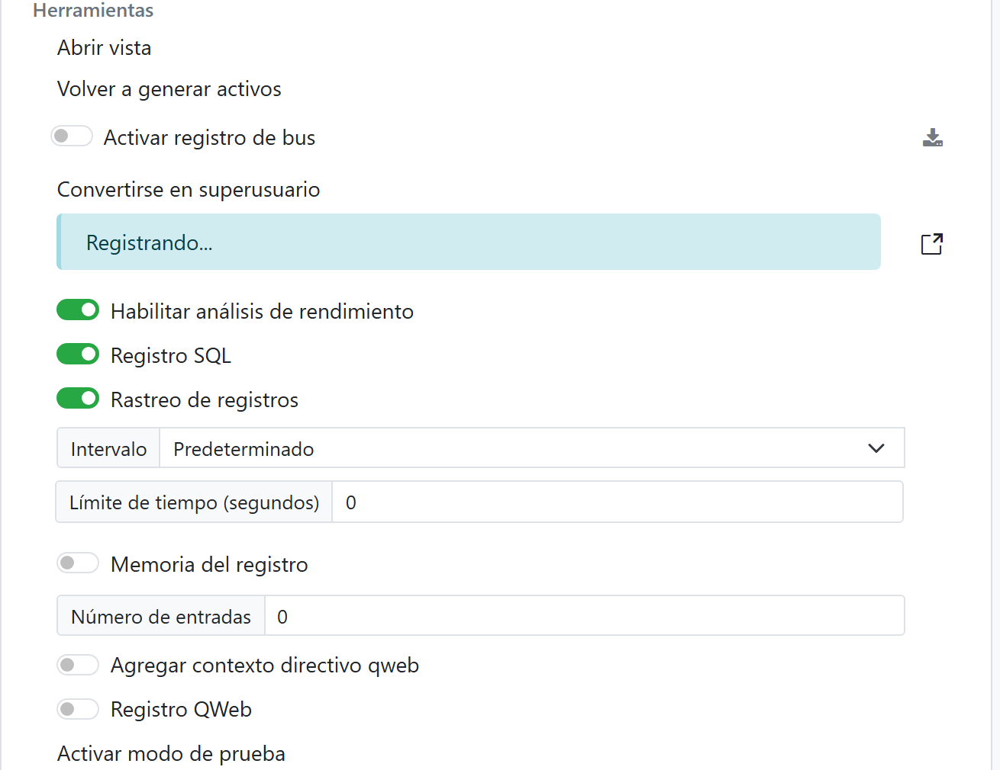
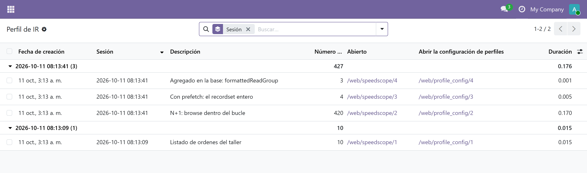
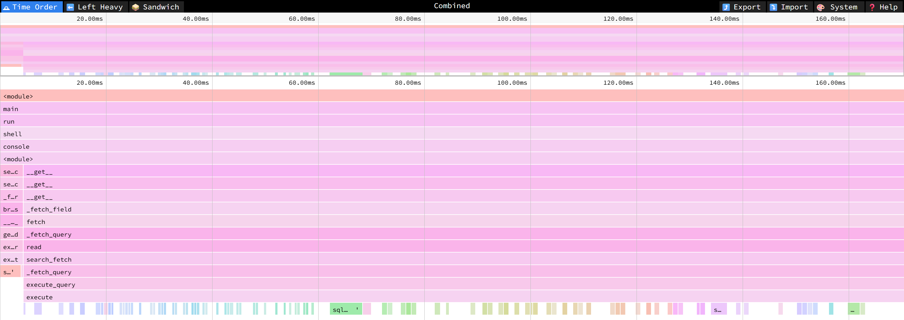
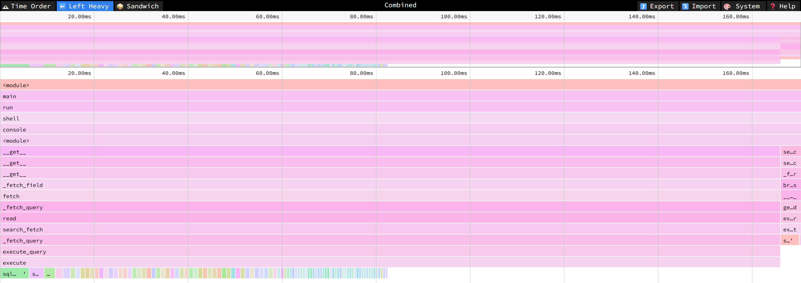

«La pantalla de órdenes va lenta» es un síntoma. Lo que sigue normalmente es media hora de hipótesis: será la base, serán los workers, será ese campo calculado.

Odoo trae un profiler integrado que convierte esa media hora en dos minutos. No hace falta instalar nada.

## Activarlo

Por seguridad viene apagado: perfilar cuesta tiempo y guarda trazas de lo que hace el servidor.

Se habilita desde **Ajustes → Técnico → Perfilado**, o directamente con el parámetro:

```python odoo shell
env["ir.config_parameter"].sudo().set_param(
    "base.profiling_enabled_until", "2026-10-12 03:24:00"
)
```

Dos avisos sobre ese parámetro:

**Tiene fecha de vencimiento a propósito.** Pasada esa hora el profiler se apaga solo, y así no queda uno encendido en producción por olvido. El asistente de la interfaz ofrece 5 minutos, 1 hora, 1 día o 1 mes.

**El formato importa.** Si le metés un `datetime` con microsegundos —lo que sale de `str(datetime.now())`— la página de Ajustes revienta al intentar leerlo:

```text
ValueError: unconverted data remains: .269762
```

`"%Y-%m-%d %H:%M:%S"`, sin fracción de segundo.

Con eso activo, el menú del bichito —el de modo desarrollador— gana un panel:



Lo que ofrece cada interruptor:

| | |
|---|---|
| **Registro SQL** | cada consulta, con su tiempo |
| **Rastreo de registros** | muestreo del stack de Python |
| **Intervalo** | cada cuánto muestrea — `0.001` para operaciones muy cortas |
| **Límite de tiempo** | corta solo a los N segundos |
| **Memoria del registro** | el uso de RSS a lo largo del perfil |
| **Número de entradas** | corta al llegar a N entradas |
| **Registro QWeb** | tiempo por directiva de plantilla, para informes lentos |

Con **SQL** y **Rastreo** encendidos tenés el 95% de los casos. Los otros son para cuando el problema es específico.

Y ese «Memoria del registro» es nuevo: te dibuja la curva de memoria del proceso durante la operación. Es lo que querés cuando un worker llega a `limit_memory_soft` y no sabés en qué paso.

Con el perfilado activo, **hacés la operación lenta**. El panel dice «Registrando…» mientras tanto. Después lo apagás.

## Perfilar desde código

Para lo que no es una petición web —un cron, una importación, un método que llamás desde el shell— el profiler es un gestor de contexto:

```python odoo shell
from odoo.tools.profiler import Profiler

with Profiler(db=env.cr.dbname, description="Listado de órdenes del taller"):
    ordenes = env["service.order"].search([])
    for o in ordenes:
        _ = o.partner_id.name
        _ = o.amount_total
env.cr.commit()
```

```text
INFO odoo.tools.profiler: ir_profile 1 (2026-10-11 08:13:09) created
```

El `description` es lo que vas a leer después en la lista, así que ponele algo que distinga una corrida de otra. Y acordate del `commit`: el perfil se guarda en la base como cualquier otro registro.

Los parámetros que vale la pena conocer:

```python
Profiler(
    db=env.cr.dbname,
    description="Cierre mensual",
    collectors=["sql", "traces_async"],   # qué recolectar
    params={"traces_async_interval": 0.001, "time_limit": 30},
    disable_gc=True,                      # para que el recolector no ensucie la medición
)
```

Los colectores disponibles son `sql`, `traces_async`, `traces_sync` y `qweb`. Los dos primeros son el default y los que querés casi siempre.

## Leer el resultado

Los perfiles quedan en **Ajustes → Técnico → Perfilado**, agrupados por sesión:



Esa captura es un experimento que corrí sobre 403 órdenes del taller. Tres formas de hacer exactamente el mismo trabajo:

| Perfil | Consultas | Duración |
|---|---|---|
| N+1: `browse` dentro del bucle | **404** | **170 ms** |
| Con prefetch: el recordset entero | 2 | 5 ms |
| Agregado en la base: `_read_group` | 1 | 0.5 ms |

Treinta y tres veces y trescientas cuarenta veces. Y lo importante: **esos números los da el profiler, no la intuición**. Mirando el código, las tres versiones parecen igual de razonables.

La columna «Duración» es lo primero que mirás. La de al lado —el número de entradas— es casi igual de informativa: **cuatrocientas entradas para listar cuatrocientos registros es la firma del N+1**, y se ve sin abrir nada.

## El flame graph

El enlace `/web/speedscope/<id>` de cada fila abre la visualización. Es [speedscope](https://www.speedscope.app/), que Odoo trae incluido.

Así se ve el perfil del N+1:



Esa franja inferior llena de barritas minúsculas, una detrás de otra durante los 170 ms, **es** el problema. Cada barrita es una consulta. No hace falta leer una sola línea de código para saber qué está pasando.

Lo que se lee en un flame graph:

**El ancho es tiempo.** Lo ancho es lo que tarda; lo alto es solo profundidad de llamadas.

**Hacia abajo es hacia adentro.** `search_fetch` → `_fetch_query` → `execute_query` → `execute` → SQL.

**Lo ancho y abajo del todo es el culpable.** Una función ancha con hijos angostos hace el trabajo ella misma. Una función ancha con un hijo igual de ancho solo está esperando a ese hijo.

Y las tres pestañas de arriba:

**Time Order** — en orden cronológico. Es la que muestra los patrones repetidos, como el de arriba.

**Left Heavy** — agrupa las llamadas iguales y las ordena por tiempo total:



Acá la lectura es inmediata: `execute_query` → `execute` ocupan casi toda la franja. **El tiempo es SQL, no Python.** Esa sola conclusión descarta la mitad de las hipótesis que uno tenía.

**Sandwich** — una tabla ordenada por tiempo propio. Útil cuando buscás una función concreta.

El flujo que funciona: **Left Heavy para saber dónde se va el tiempo, Time Order para entender por qué**.

## Perfilar en producción

Sí se puede, con cuidado:

**Habilitalo por poco tiempo.** El asistente ofrece 5 minutos por algo.

**Perfilá una operación, no una sesión.** Activás, hacés la cosa lenta, desactivás.

**Usá `time_limit` y `entry_count_limit`.** Una operación que no termina genera un perfil enorme; esos dos límites lo cortan.

**Es por sesión de usuario**, no global. Solo se perfila lo que hace quien lo activó. El resto de los usuarios no se entera.

**Los perfiles ocupan espacio.** Odoo los borra solos a los 30 días con su autovacuum, pero si perfilás mucho conviene mirarlo.

Y el aviso que importa: **un perfil guarda las consultas SQL con sus valores**. Si la operación toca datos sensibles, eso queda en la tabla. No es información para compartir alegremente ni para dejar ahí para siempre.

## Del perfil a la causa

Encontrar el punto lento es la mitad. La otra mitad es leer bien qué dice:

**Tiempo en SQL, muchas consultas chicas** → N+1. Prefetch roto. La próxima lección.

**Tiempo en SQL, una consulta grande** → falta un índice, o el dominio trae demasiado.

**Tiempo en Python, una función ancha** → un bucle, un cálculo caro, un campo calculado que se dispara de más.

**Tiempo repartido en todo** → probablemente traés demasiados registros. El problema es el volumen, no una línea.

**Tiempo en QWeb** → un informe con un bucle que accede a relaciones. Encendé el colector `qweb` y vas a ver qué directiva.

## Medir antes y después

Lo que cierra el círculo: **el mismo perfil, con el arreglo puesto**.

Es la única forma de saber si la optimización sirvió de algo, y de cuánto. La tabla de los tres perfiles de arriba es exactamente eso, y es también la respuesta cuando alguien pregunta si valió la pena el rato que le dedicaste.

Sin esa segunda medición, optimizar es una creencia.

> **Quedate con esto**
> El profiler se habilita con `base.profiling_enabled_until` —con vencimiento, y en formato `%Y-%m-%d %H:%M:%S` o la página de Ajustes revienta— y desde código es `with Profiler(db=..., description=...)`. En la lista, **el número de entradas delata el N+1 sin abrir nada**: 404 entradas para listar 403 registros. En speedscope, Left Heavy dice *dónde* se va el tiempo y Time Order dice *por qué*. Y una optimización sin la segunda medición es una creencia, no un resultado.
