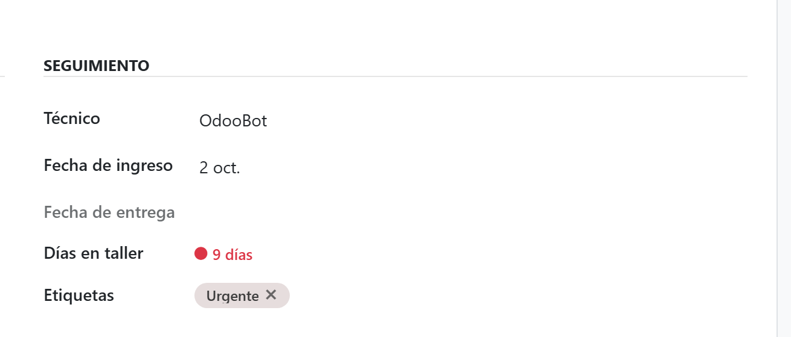

Acá el semáforo deja de ser un componente suelto y se convierte en **un widget de campo**: algo que ponés en una vista con `widget="sla_light"` y que lee el registro que tiene delante.

Es la forma más común de agregar algo propio al cliente web de Odoo, y la que más rendimiento da por línea escrita.

## Las dos piezas

Un widget de campo son **un componente** y **un objeto descriptor** que lo registra.

```javascript service_workshop/static/src/fields/sla_light/sla_light_field.js
import { Component } from "@odoo/owl";
import { _t } from "@web/core/l10n/translation";
import { registry } from "@web/core/registry";
import { standardFieldProps } from "@web/views/fields/standard_field_props";

export class SlaLightField extends Component {
    static template = "service_workshop.SlaLightField";

    static props = {
        ...standardFieldProps,
        limite: { type: Number, optional: true },
    };

    static defaultProps = { limite: 5 };

    get dias() {
        return this.props.record.data[this.props.name] || 0;
    }

    get nivel() {
        if (this.dias >= this.props.limite) return "late";
        if (this.dias >= this.props.limite - 2) return "warn";
        return "ok";
    }

    get titulo() {
        return _t("Límite del SLA: %s días", this.props.limite);
    }
}

export const slaLightField = {
    component: SlaLightField,
    displayName: _t("Semáforo de SLA"),
    supportedTypes: ["integer"],
    supportedOptions: [
        {
            label: _t("Límite en días"),
            name: "limite",
            type: "number",
        },
    ],
    extractProps: ({ options }) => ({
        limite: options.limite,
    }),
};

registry.category("fields").add("sla_light", slaLightField);
```

```xml service_workshop/static/src/fields/sla_light/sla_light_field.xml
<?xml version="1.0" encoding="UTF-8" ?>
<templates xml:space="preserve">

    <t t-name="service_workshop.SlaLightField">
        <span class="o_sla_light d-inline-flex align-items-center gap-1"
              t-att-class="'o_sla_' + nivel"
              t-att-title="titulo">
            <i class="fa fa-circle small"/>
            <span><t t-esc="dias"/> días</span>
        </span>
    </t>

</templates>
```

## `standardFieldProps`

```javascript
static props = {
    ...standardFieldProps,
    limite: { type: Number, optional: true },
};
```

Esas son las props que **Odoo le pasa a todo widget de campo**. Las desparramás con `...` y agregás las tuyas.

Las que vas a usar:

| Prop | Qué es |
|---|---|
| `record` | el registro completo |
| `name` | el nombre del campo que te tocó |
| `readonly` | si está en modo lectura |
| `id` | el id del nodo, para `<label for>` |

**No las declares a mano.** Si Odoo agrega una prop nueva en otra versión, `standardFieldProps` la trae sola; una lista escrita a mano se rompe.

## Leer el valor

```javascript
get dias() {
    return this.props.record.data[this.props.name] || 0;
}
```

Acá está la pieza clave: **`record.data[name]`**, no `record.data.days_in_shop`.

Usar `this.props.name` en vez del nombre fijo es lo que hace que el widget sirva **en cualquier campo entero de cualquier modelo**. Si lo escribís a mano, acabás de atar tu widget a un solo campo.

El registro trae más de lo que parece:

```javascript
this.props.record.data[this.props.name]       // el valor
this.props.record.fields[this.props.name]     // la definición: tipo, string, selection…
this.props.record.resModel                    // "service.order"
this.props.record.resId                       // el id, o false si es nuevo
this.props.record.isNew                       // si todavía no se guardó
this.props.record.data.state                  // ¡cualquier otro campo de la vista!
```

Esa última línea es importante: **podés leer otros campos del registro**, siempre que estén en la vista. Es lo que te deja decidir el color según el estado además de los días.

Lo que **no** podés es leer un campo que la vista no cargó. Si lo necesitás, va en la vista con `invisible="1"`, igual que en el backend.

## El descriptor

```javascript
export const slaLightField = {
    component: SlaLightField,
    displayName: _t("Semáforo de SLA"),
    supportedTypes: ["integer"],
    supportedOptions: [ /* ... */ ],
    extractProps: ({ options }) => ({ limite: options.limite }),
};
```

- **`component`** — la clase.
- **`displayName`** — el nombre que ve quien edita la vista desde la interfaz.
- **`supportedTypes`** — en qué tipos de campo se puede usar. Si alguien lo pone en un `char`, Odoo avisa.
- **`supportedOptions`** — las opciones que acepta, para que aparezcan documentadas.
- **`extractProps`** — traduce lo que dice el XML a props de tu componente. Tiene su propia lección.

## Usarlo en la vista

```xml service_workshop/views/service_order_views.xml
<field name="days_in_shop" widget="sla_light" options="{'limite': 7}"/>
```

Un `-u service_workshop`, recargás, y el semáforo está en el formulario:


*El rojo sale del `limite: 7` que pasó el XML por `extractProps`; el tooltip traducido, de `_t`.*

## Traducciones

```javascript
import { _t } from "@web/core/l10n/translation";

_t("Semáforo de SLA")
_t("Límite del SLA: %s días", this.props.limite)
```

`_t` es el equivalente del `_()` de Python. **Todo texto visible va adentro**, o no se puede traducir.

Y una regla que vale la pena: `_t` se llama **donde se usa el texto**, no al cargar el módulo. Si guardás el resultado en una constante global, se traduce una vez con el idioma de ese momento y se queda así. En el ejemplo está dentro de un getter, que es lo correcto.

## El formateador, cuando hace falta

Nuestro campo es un entero y lo mostramos crudo. Para un `Monetary` o una fecha hay que formatear:

```javascript
import { formatMonetary } from "@web/views/fields/formatters";

get importeFormateado() {
    return formatMonetary(this.props.record.data[this.props.name], {
        currencyId: this.props.record.data.currency_id?.[0],
    });
}
```

Esto es **lo que el `t-field` del servidor hacía solo**. En el cliente hay que pedirlo. Los formateadores están en `@web/views/fields/formatters` y también en el registry `formatters`, que es lo que usa el `BadgeField` del core.

## Lo que puede salir mal

| Error | Causa |
|---|---|
| `Invalid field widget "sla_light"` | el archivo no está en el bundle, o el registro no corrió |
| `Cannot read properties of undefined (reading 'data')` | te faltó desparramar `standardFieldProps` |
| El valor sale vacío | usaste el nombre del campo a mano en vez de `this.props.name` |
| `Missing template` | el `t-name` no coincide con el `static template` |
| Anda en el formulario, no en la lista | tu plantilla asume espacio que una celda no tiene |

> **Quedate con esto**
> Un widget de campo son un componente y un descriptor registrado en la categoría `fields`. Desparramá `standardFieldProps` en vez de declarar las props a mano, y leé el valor con `record.data[this.props.name]` —nunca con el nombre fijo— o atás el widget a un solo campo. Y acordate de que en el cliente el formateo no es automático: el `t-field` del servidor no existe acá.
