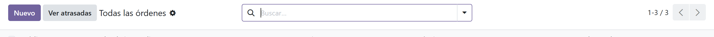

Casi nunca necesitás una vista nueva. Lo que necesitás es que **la lista de órdenes** tenga un botón que las otras listas no tienen.

Para eso se hereda la vista existente y se registra una variante.

## El patrón

Tres pasos: heredás la clase, armás el objeto de vista, lo registrás con un nombre nuevo.

```javascript service_workshop/static/src/views/order_list/order_list_controller.js
import { ListController } from "@web/views/list/list_controller";
import { listView } from "@web/views/list/list_view";
import { registry } from "@web/core/registry";
import { useService } from "@web/core/utils/hooks";
import { _t } from "@web/core/l10n/translation";

export class OrderListController extends ListController {
    setup() {
        super.setup();
        this.action = useService("action");
        this.orm = useService("orm");
    }

    async abrirAtrasadas() {
        const ids = await this.orm.search("service.order", [
            ["days_in_shop", ">", 7],
            ["state", "not in", ["done", "cancel"]],
        ]);
        this.action.doAction({
            type: "ir.actions.act_window",
            name: _t("Órdenes atrasadas"),
            res_model: "service.order",
            view_mode: "list,form",
            domain: [["id", "in", ids]],
        });
    }
}

export const orderListView = {
    ...listView,
    Controller: OrderListController,
    buttonTemplate: "service_workshop.OrderListButtons",
};

registry.category("views").add("order_list", orderListView);
```

Fijate el `...listView`: **tomás todo lo de la vista de lista y reemplazás solo lo que cambia**. Así heredás el Renderer, el Model y el ArchParser sin escribirlos.

## El `super.setup()` que no se olvida

```javascript
setup() {
    super.setup();
    this.action = useService("action");
}
```

Igual que en el backend con `super()`: si no lo llamás, la inicialización original no corre y la vista queda rota de formas difíciles de diagnosticar.

Y los hooks van **después** del `super.setup()`, porque la clase padre registra los suyos primero.

## El botón

```xml service_workshop/static/src/views/order_list/order_list.xml
<?xml version="1.0" encoding="UTF-8" ?>
<templates xml:space="preserve">

    <t t-name="service_workshop.OrderListButtons">
        <button type="button" class="btn btn-secondary"
                t-on-click="() => this.abrirAtrasadas()"
                data-hotkey="shift+a">
            Ver atrasadas
        </button>
    </t>

</templates>
```


*«Ver atrasadas» no existe en ninguna otra lista de Odoo: sale del `buttonTemplate` de nuestra vista.*

El `data-hotkey` es un detalle que Odoo usa en todos sus botones: le da un atajo de teclado gratis.

> **Acá no se hereda, se reemplaza**
> Uno espera tener que heredar `web.ListView.Buttons` con un `xpath`. **En Odoo 19 esa plantilla está vacía**: en el fuente es literalmente `<t t-name="web.ListView.Buttons"/>`, un hueco pensado para que lo llenes. Escribila entera y listo.
>
> Si intentás heredarla con un `xpath`, el xpath no encuentra nada y lo que ves es un error de ciclo de vida de OWL en pantalla, que no menciona la plantilla por ningún lado. Me pasó al escribir esta lección.

## Decirle a la vista que use la tuya

```xml service_workshop/views/service_order_views.xml
<record id="view_service_order_list" model="ir.ui.view">
    <field name="name">service.order.list</field>
    <field name="model">service.order</field>
    <field name="arch" type="xml">
        <list string="Órdenes de servicio" js_class="order_list">
            ...
        </list>
    </field>
</record>
```

**`js_class`** es el puente entre el XML del backend y tu JavaScript. El valor es el nombre con el que registraste la vista.

Es una sola palabra y es lo que mucha gente no encuentra: escriben todo el JavaScript, lo registran, y la vista sigue siendo la normal porque falta este atributo.

## `patch`: cuando no podés registrar una variante

A veces querés cambiar el comportamiento **de todas** las instancias, no de una vista particular. Por ejemplo, agregar un atajo de teclado global en todas las listas.

```javascript
import { patch } from "@web/core/utils/patch";
import { ListRenderer } from "@web/views/list/list_renderer";

patch(ListRenderer.prototype, {
    setup() {
        super.setup();
        this.miExtra = true;
    },
});
```

Ya lo vimos en la lección de registries. El recordatorio: **afecta a toda la aplicación**, y si dos módulos parchan lo mismo el orden de carga decide.

La regla: **heredá y registrá cuando puedas; parchá solo cuando no haya forma**.

## Heredar el Renderer

Cuando lo que querés cambiar es cómo se dibuja:

```javascript
import { ListRenderer } from "@web/views/list/list_renderer";

export class OrderListRenderer extends ListRenderer {
    static template = "service_workshop.OrderListRenderer";

    getRowClass(record) {
        const clases = super.getRowClass(record);
        if (record.data.days_in_shop > 7) {
            return `${clases} table-danger`;
        }
        return clases;
    }
}

export const orderListView = {
    ...listView,
    Controller: OrderListController,
    Renderer: OrderListRenderer,
};
```

`getRowClass` es un método del `ListRenderer` del core pensado para esto. **Antes de inventar un mecanismo, buscá si ya existe un gancho**: el renderizador de listas tiene varios.

```bash Terminal · encontrar los ganchos
grep -n "    get\|    on\|    can" addons/web/static/src/views/list/list_renderer.js | head -40
```

## Lo que puede salir mal

| Síntoma | Causa |
|---|---|
| La vista se ve igual que siempre | falta `js_class` en el XML |
| `Cannot read properties of undefined` en el setup | te olvidaste de `super.setup()` |
| El botón no aparece | la plantilla no hereda de la correcta, o el xpath no resolvió |
| Rompió otras listas | usaste `extension` en la plantilla, o `patch` |
| `View type order_list not found` | el archivo no está en el bundle |

El primero es, con diferencia, el más común.

> **Quedate con esto**
> `...listView` te deja reemplazar una pieza y heredar las otras tres. `js_class` en el XML es lo que conecta el backend con tu JavaScript, y es lo que falta cuando «escribí todo y no pasa nada». Y antes de reescribir un método del Renderer, buscá si ya existe un gancho pensado para eso.
