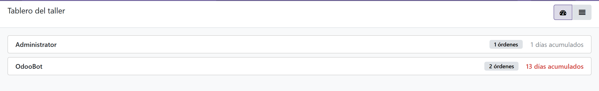

Heredar alcanza para el 95% de los casos. Esta lección es sobre el 5% restante: cuando la pantalla que necesitás no se parece a ninguna de las de Odoo.

Nuestro caso: **un tablero de carga del taller**, que muestra cada técnico con sus órdenes abiertas y cuánto trabajo acumula. No es una lista, ni un kanban, ni un gráfico.

## Lo primero: ¿de verdad hace falta?

Antes de escribir una vista, descartá las salidas baratas:

- **Un kanban agrupado** con `default_group_by="user_id"` — es gratis y cubre mucho.
- **Un modelo sobre una vista SQL** con una vista pivot o gráfico encima. Vimos los modelos SQL en el curso de backend.
- **Una acción de cliente** (`ir.actions.client`), que es un componente OWL suelto sin la maquinaria de vista. Más simple si no necesitás la barra de búsqueda.

Una vista propia tiene sentido cuando querés **la barra de búsqueda, los filtros, el dominio y el contexto** funcionando como en cualquier otra vista de Odoo. Si no los necesitás, una acción de cliente es menos código.

## Las piezas mínimas

```text
static/src/views/workshop_board/
├── workshop_board_view.js        el objeto
├── workshop_board_controller.js  el componente raíz
├── workshop_board_model.js       de dónde salen los datos
├── workshop_board.xml            la plantilla
└── workshop_board.scss
```

## El ArchParser

```javascript service_workshop/static/src/views/workshop_board/workshop_board_arch_parser.js
export class WorkshopBoardArchParser {
    parse(xmlDoc) {
        return {
            limiteSla: parseInt(xmlDoc.getAttribute("limite_sla") || "7", 10),
            campoAgrupacion: xmlDoc.getAttribute("agrupar_por") || "user_id",
        };
    }
}
```

Lee el XML de la vista y devuelve configuración. Con eso, el XML del backend puede ser:

```xml
<workshop_board limite_sla="7" agrupar_por="user_id"/>
```

Corre una sola vez, al abrir.

## El Model

```javascript service_workshop/static/src/views/workshop_board/workshop_board_model.js
export class WorkshopBoardModel {
    constructor(env, params, services) {
        this.orm = services.orm;
        this.resModel = params.resModel;
        this.campo = params.campoAgrupacion;
        this.grupos = [];
    }

    async load(params) {
        const dominio = params.domain || [];
        const filas = await this.orm.formattedReadGroup(
            this.resModel,
            [...dominio, ["state", "not in", ["done", "cancel"]]],
            [this.campo],
            ["__count", "days_in_shop:sum", "amount_total:sum"],
        );
        this.grupos = filas.map((f) => {
            const valor = f[this.campo];
            return {
                id: Array.isArray(valor) ? valor[0] : valor || false,
                nombre: Array.isArray(valor) ? valor[1] : "Sin asignar",
                cantidad: f.__count || 0,
                dias: f["days_in_shop:sum"] || 0,
                importe: f["amount_total:sum"] || 0,
            };
        });
    }
}
```

Fijate que pide **totales agrupados** en vez de traer todos los registros para sumarlos en el navegador. Es la misma lección de `_read_group` del curso de backend, del lado del cliente.

> **Si venís de versiones anteriores**
> El método se llamaba `readGroup(model, domain, fields, groupby)`. **En Odoo 19 es `formattedReadGroup` y cambió el orden**: los `groupby` van **antes** que los agregados. Además el conteo se pide explícitamente con `"__count"` y vuelve en `f.__count`, en vez del viejo `f.campo_count`. Si llamás al nombre viejo, el error es un `TypeError` dentro del ciclo de vida de OWL que no menciona el ORM por ningún lado.

Y fijate que **respeta el `params.domain`**: eso es lo que hace que la barra de búsqueda funcione sobre tu vista.

## El Controller

```javascript service_workshop/static/src/views/workshop_board/workshop_board_controller.js
import { Component, onWillStart, useState } from "@odoo/owl";
import { Layout } from "@web/search/layout";
import { useService } from "@web/core/utils/hooks";
import { standardViewProps } from "@web/views/standard_view_props";
import { useModelWithSampleData } from "@web/model/model";

export class WorkshopBoardController extends Component {
    static template = "service_workshop.WorkshopBoard";
    static components = { Layout };
    static props = { ...standardViewProps, Model: Function, archInfo: Object };

    setup() {
        this.action = useService("action");
        this.orm = useService("orm");
        this.state = useState({ grupos: [] });

        this.model = new this.props.Model(this.env, {
            resModel: this.props.resModel,
            campoAgrupacion: this.props.archInfo.campoAgrupacion,
        }, { orm: this.orm });

        onWillStart(async () => {
            await this.model.load({ domain: this.props.domain });
            this.state.grupos = this.model.grupos;
        });
    }

    abrirGrupo(grupo) {
        this.action.doAction({
            type: "ir.actions.act_window",
            res_model: this.props.resModel,
            view_mode: "list,form",
            domain: [
                [this.props.archInfo.campoAgrupacion, "=", grupo.id],
                ["state", "not in", ["done", "cancel"]],
            ],
        });
    }
}
```

`onWillStart` para cargar antes de pintar, de la lección del ciclo de vida. Y `standardViewProps` desparramado, igual que `standardFieldProps` en los widgets: **son las props que Odoo le pasa a toda vista** y no conviene listarlas a mano.

## La plantilla con `Layout`

```xml service_workshop/static/src/views/workshop_board/workshop_board.xml
<t t-name="service_workshop.WorkshopBoard">
    <Layout className="'o_workshop_board'" display="props.display">
        <div class="o_workshop_board_content p-3">
            <div t-if="!state.grupos.length" class="text-muted">
                No hay órdenes abiertas.
            </div>
            <div t-foreach="state.grupos" t-as="g" t-key="g.id"
                 class="card mb-2"
                 t-on-click="() => this.abrirGrupo(g)">
                <div class="card-body d-flex justify-content-between">
                    <span t-esc="g.nombre"/>
                    <span>
                        <span class="badge text-bg-secondary me-2">
                            <t t-esc="g.cantidad"/> órdenes
                        </span>
                        <span t-esc="g.dias"/> días acumulados
                    </span>
                </div>
            </div>
        </div>
    </Layout>
</t>
```

**`Layout`** es el componente que aporta el cromo del cliente web: el panel de control, la barra de búsqueda, el selector de vistas. Envolver tu contenido en él es lo que hace que tu vista propia **no se sienta ajena**.

Sin `Layout` tenés una página en blanco sin barra de búsqueda, y tenés que reinventar todo eso.

## El objeto y el registro

```javascript service_workshop/static/src/views/workshop_board/workshop_board_view.js
import { registry } from "@web/core/registry";
import { WorkshopBoardController } from "./workshop_board_controller";
import { WorkshopBoardModel } from "./workshop_board_model";
import { WorkshopBoardArchParser } from "./workshop_board_arch_parser";

export const workshopBoardView = {
    type: "workshop_board",
    display_name: "Tablero del taller",
    icon: "fa fa-tachometer",
    multiRecord: true,

    Controller: WorkshopBoardController,
    Model: WorkshopBoardModel,
    ArchParser: WorkshopBoardArchParser,

    props: (genericProps, view) => {
        const archInfo = new view.ArchParser().parse(genericProps.arch);
        return { ...genericProps, archInfo, Model: view.Model };
    },
};

registry.category("views").add("workshop_board", workshopBoardView);
```

- **`type`** — el nombre, y es lo que va en `view_mode`.
- **`display_name`** e **`icon`** — cómo aparece en el selector de vistas.
- **`props`** — arma las props del Controller a partir de las genéricas.

## Usarla desde el backend

```xml service_workshop/views/service_order_views.xml
<record id="view_service_order_board" model="ir.ui.view">
    <field name="name">service.order.board</field>
    <field name="model">service.order</field>
    <field name="arch" type="xml">
        <workshop_board limite_sla="7" agrupar_por="user_id"/>
    </field>
</record>

<record id="action_service_order" model="ir.actions.act_window">
    ...
    <field name="view_mode">kanban,workshop_board,list,form</field>
</record>
```

El elemento raíz del `arch` tiene que llamarse igual que el `type` de la vista.

## El paso que falta en todos los tutoriales

Con lo anterior, el módulo **no instala**: falla con `Invalid view type: 'workshop_board'`.

Registrar la vista en el registry solo se lo dice al cliente. **El servidor valida el tipo contra un campo Selection**, así que hace falta Python:

```python service_workshop/models/ir_ui_view.py
from odoo import fields, models


class IrUiView(models.Model):
    _inherit = "ir.ui.view"

    type = fields.Selection(
        selection_add=[("workshop_board", "Tablero del taller")],
        ondelete={"workshop_board": "cascade"},
    )

    def _get_view_info(self):
        return {
            "workshop_board": {"icon": "fa fa-tachometer", "multi_record": True},
            **super()._get_view_info(),
        }
```

Son **dos** declaraciones, no una, y la segunda es la que más cuesta encontrar:

- El **Selection** hace que el módulo instale.
- **`_get_view_info`** hace que el tipo llegue al cliente en `session.view_info`, de donde además sale el ícono del selector de vistas.

Sin la segunda, el módulo instala bien pero al abrir la acción el cliente tira `View types not defined workshop_board`. La razón está en el fuente: el registry de vistas valida con `type: { validate: (t) => t in session.view_info }`, y `get_view_info` solo devuelve los tipos que están **en el Selection y además en `_get_view_info`**.

Con las tres piezas en su lugar:


*Los «13 días acumulados» salen en rojo por el `limite_sla="7"` que el ArchParser leyó del XML.*

## El coste

Una vista propia son cinco archivos, props que entender, y **código que hay que revisar en cada actualización de Odoo**, porque usa APIs internas del cliente web que no tienen garantía de estabilidad.

Vale la pena cuando la pantalla es central para el negocio y ninguna vista estándar la resuelve. Para todo lo demás, un kanban agrupado rinde mucho más por el esfuerzo.

> **Quedate con esto**
> Antes de escribir una vista, probá con un kanban agrupado o una acción de cliente. Si la escribís, envolvé todo en `Layout` para heredar el panel de control y la barra de búsqueda, y respetá el `domain` que te llega — eso es lo que hace que los filtros funcionen. El elemento raíz del arch tiene que llamarse igual que el `type` registrado.
