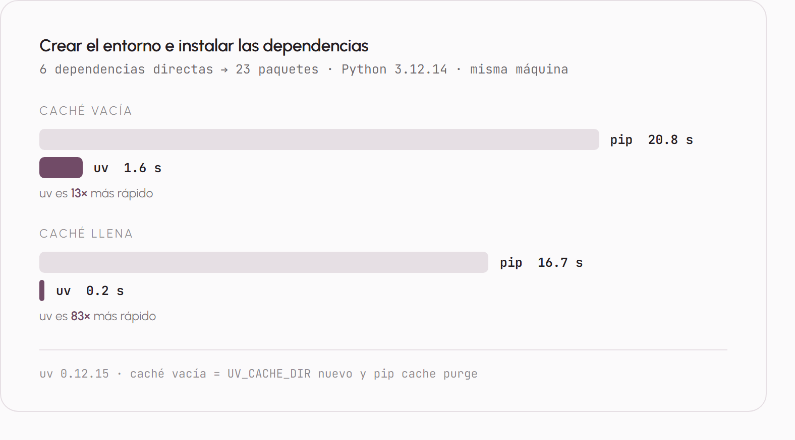
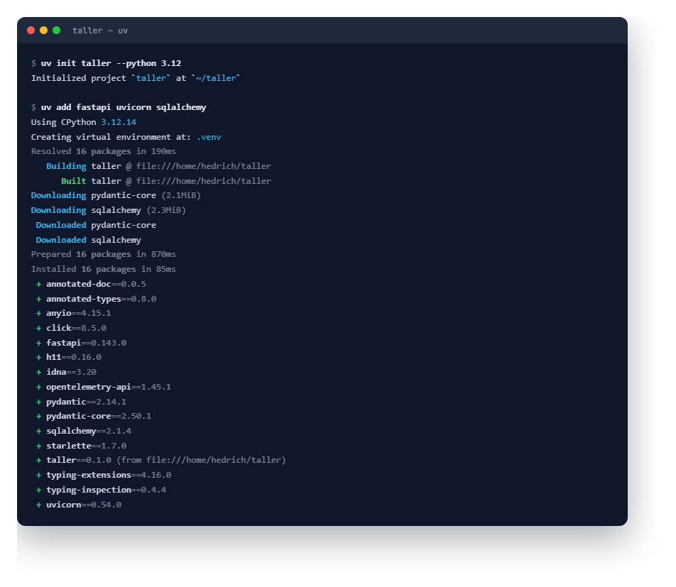

Python arrastra una herramienta por problema: `venv` para el entorno, `pip` para instalar, `pip-tools` o Poetry para fijar versiones, `pyenv` para la versión del intérprete, `pipx` para los comandos sueltos. Cinco cosas que aprender, cinco que explicar al que entra al proyecto.

[uv](https://docs.astral.sh/uv/) las reemplaza a todas. Está escrito en Rust y la diferencia de velocidad no es marginal.

## Los números, medidos

Lo primero que se dice de uv es que es rápido. Lo medí en mi máquina: seis dependencias directas que se resuelven en 23 paquetes, mismo Python 3.12.14, el mismo trabajo de punta a punta — crear el entorno e instalar todo.



Un detalle que explica el segundo caso: **pip también cachea las descargas** y aun así tarda 16.7 s. Lo que cambia no es bajar los archivos, es qué pasa después. pip descomprime y copia cada archivo al entorno; uv hace *hardlinks* desde su caché, que es casi gratis.

Por eso la mejora grande no está en la instalación inicial sino en todas las demás: cada vez que creás un entorno, cambiás de rama o reconstruís un contenedor.

## Instalarlo

```bash Terminal · Linux y macOS
curl -LsSf https://astral.sh/uv/install.sh | sh
```

```powershell Terminal · Windows
powershell -c "irm https://astral.sh/uv/install.ps1 | iex"
```

No necesita que tengas Python: el instalador es un binario único. De hecho uv **instala Python por vos**, que es lo que elimina a `pyenv` del mapa.

## Los tres comandos que vas a usar

```bash Terminal
uv init taller --python 3.12      # crea el proyecto
uv add fastapi uvicorn sqlalchemy # agrega dependencias
uv run uvicorn main:app --reload  # ejecuta
```



Eso es todo el flujo. Tres cosas que no hiciste y vale la pena notar:

**No creaste el entorno.** `uv add` lo crea solo la primera vez.

**No activaste nada.** `uv run` encuentra el `.venv` del proyecto y usa su intérprete. Olvidarte del `source .venv/bin/activate` deja de ser un problema porque deja de existir.

**No editaste el `pyproject.toml` a mano.** `uv add` lo escribe:

```toml pyproject.toml
[project]
name = "taller"
requires-python = ">=3.12"
dependencies = [
    "fastapi>=0.143.0",
    "sqlalchemy>=2.1.4",
    "uvicorn>=0.54.0",
]
```

Las de desarrollo van aparte y no se instalan en producción:

```bash Terminal
uv add --dev pytest
```

```toml pyproject.toml
[dependency-groups]
dev = ["pytest>=9.1.1"]
```

## Lo que de verdad importa: el lockfile

La velocidad es lo que se nota el primer día. Lo que se agradece a los seis meses es el `uv.lock`.

`uv add` lo genera solo, y guarda **la versión exacta de cada paquete, incluidas las transitivas, con su hash**. Eso es lo que `requirements.txt` nunca te dio: con `fastapi>=0.143.0`, dos personas instalando la misma semana pueden terminar con árboles distintos.

```bash Terminal · en CI y en el Dockerfile
uv sync --frozen
```

**`--frozen` falla si el lock no coincide con el `pyproject.toml`**, en vez de resolver de nuevo por su cuenta. Es la diferencia entre un despliegue reproducible y uno que te instala una versión nueva de una transitiva un martes cualquiera.

El lock va al repositorio. Siempre.

## Migrar un proyecto que ya existe

No hace falta reescribir nada para empezar:

```bash Terminal
uv venv
uv pip install -r requirements.txt
```

`uv pip` es un reemplazo directo: mismos flags, mismo comportamiento, otra velocidad. Si solo querés que el CI deje de tardar, con eso alcanza y no tocás más nada.

Y cuando quieras pasar al modelo con lockfile, la puerta de salida existe:

```bash Terminal
uv export --no-hashes --no-dev -o requirements.txt
```

Útil si tenés algo que todavía espera un `requirements.txt` — un servicio gestionado, un `Dockerfile` ajeno.

## Dos cosas que no esperaba usar tanto

**Scripts con sus dependencias adentro.** Un archivo suelto que necesita `httpx` no necesita un proyecto:

```python script.py
# /// script
# requires-python = ">=3.12"
# dependencies = ["httpx"]
# ///
import httpx
print(httpx.get("https://hedrich.dev").status_code)
```

```bash Terminal
uv run script.py
```

```text
Installed 7 packages in 26ms
```

uv lee ese encabezado —es [PEP 723](https://peps.python.org/pep-0723/), no un invento suyo—, arma un entorno efímero y lo ejecuta. El script sigue siendo un archivo que podés mandar por chat y que corre en la máquina del otro sin instrucciones. `uv add --script script.py rich` actualiza el encabezado por vos.

**Comandos de una sola vez.** `uvx` corre una herramienta sin instalarla en ningún lado:

```bash Terminal
uvx ruff check .
uvx --from httpie http --version
```

Es `pipx`, sin el paso de instalar.

## En Docker

El patrón que uso, con el lock copiado antes que el código para que la capa de dependencias se cachee:

```dockerfile Dockerfile
FROM python:3.12-slim

# fijá la versión en serio; `latest` acá es para que se lea
COPY --from=ghcr.io/astral-sh/uv:0.13.0 /uv /uvx /bin/

WORKDIR /app
COPY pyproject.toml uv.lock ./
RUN uv sync --frozen --no-dev --no-install-project

COPY . .
RUN uv sync --locked --no-dev

ENV PATH="/app/.venv/bin:$PATH"
CMD ["uvicorn", "main:app", "--host", "0.0.0.0"]
```

**`--no-install-project` en el primer `sync`** es lo que hace que funcione el caché: instala solo las dependencias y no tu paquete, así cambiar una línea de tu código no vuelve a bajar nada.

**`--locked` en el segundo** verifica que el lock siga coincidiendo con el `pyproject.toml` y falla si no.

`ENV PATH` al `.venv/bin` deja los comandos disponibles sin activar el entorno ni envolver todo en `uv run`.

Y lo que arruina esto si te lo olvidás:

```text .dockerignore
.venv
```

El entorno es específico de la plataforma. Si el `.venv` de tu máquina se cuela en la imagen, pisa el que se construyó adentro y te deja binarios que no corren.

## Cuándo no

Para ser honesto sobre los límites:

**Si el proyecto ya usa Poetry y funciona**, migrar por migrar no paga. uv gana claro en proyectos nuevos y en los que todavía están con `requirements.txt`.

**Si dependés de un paquete sin ruedas** que compila desde fuente, el cuello de botella es el compilador y uv no lo arregla.

**En conda y el stack científico con binarios del sistema**, conda sigue resolviendo cosas que uv no intenta resolver.

Fuera de esos casos, es la primera herramienta de Python en mucho tiempo que quita trabajo en vez de agregar una capa más.

> **Quedate con esto**
> `uv init`, `uv add`, `uv run` y no volvés a activar un entorno. Lo que vende es la velocidad —medido acá, 13× con la caché vacía y 83× con la caché llena, porque uv hace hardlinks en vez de copiar—, pero lo que te salva a los seis meses es el `uv.lock` con las transitivas fijadas y `uv sync --frozen` en el CI. Y si ya tenés un proyecto, `uv pip install -r requirements.txt` funciona hoy sin cambiar nada más.
